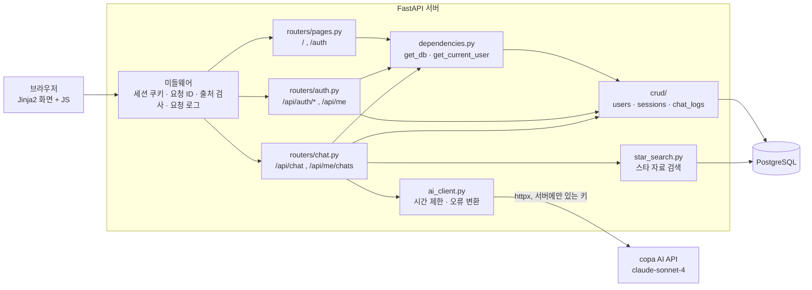
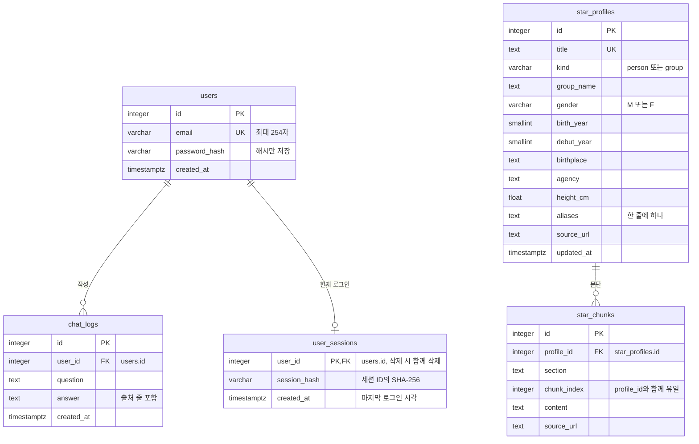

# Next Star Hunter (다음 아이돌 발굴가)

> **“내 눈은 틀리지 않아, 얘는 무조건 뜬다!”**

사용자의 취향과 조건을 바탕으로 아이돌·배우·가수 등 스타를 추천하는 웹 기반 AI 챗봇 서비스입니다. 로그인한 사용자가 자연어로 조건을 입력하면 서버가 스타 자료를 찾아 AI API에 함께 넘기고, 받은 답변을 화면에 보여 주며 질문과 답변을 사용자별 대화 기록으로 저장합니다.

- 저장소: https://github.com/innurhap28/Next-Star-Hunter.bot
- 서비스 주소: 배포 후 추가

## 1. 프로젝트 개요

- **문제 정의**: 관심 있는 스타를 외모·프로필 취향에 맞춰 발견하고 싶지만, 출신 지역·데뷔 시기·그룹 같은 조건을 조합해 찾아보기 어렵습니다.
- **대상 사용자**: 새로운 아이돌, 배우, 가수 등을 취향에 맞춰 찾아보고 싶은 사용자입니다.
- **핵심 시나리오**: 회원가입·로그인 → “안경을 쓴 부산 출신 아이돌을 추천해줘”처럼 질문 → 서버가 스타 자료를 찾고 AI가 1~3명을 이유와 함께 추천 → “그중에 보조개 있는 사람은?”처럼 이어서 질문 → 다음에 접속해도 이전 대화가 그대로 보입니다.

## 2. 주요 기능

| 기능 | 내용 |
| --- | --- |
| 회원가입·로그인 | 이메일과 비밀번호(8~128자)로 가입합니다. 비밀번호는 해시만 저장하고, 로그인하면 서명된 세션 쿠키가 발급됩니다. |
| 비로그인 제한 | 로그인하지 않으면 채팅 화면(`/`)이 로그인 화면(`/auth`)으로 이동하고, 채팅·기록 API는 `401 LOGIN_REQUIRED`를 돌려줍니다. |
| 채팅 흐름 | 화면에서 질문 → `POST /api/chat` → 서버가 AI API 호출 → 답변을 화면에 표시하고 DB에 저장합니다. |
| 문맥 유지 | 같은 사용자의 최근 질문·답변 5쌍을 AI 요청에 함께 넣어 이어지는 질문을 이해합니다. |
| 스타 자료 검색 | 질문에서 지역·성별·데뷔연도·그룹명 같은 조건을 뽑아 나무위키 기반 스타 테이블을 검색하고, 찾은 자료를 AI에 참고 자료로 넘깁니다. 답변 끝에 출처를 붙입니다. |
| 대화 기록 조회 | `GET /api/me/chats`로 본인 기록만 조회합니다. 채팅 화면을 열면 최근 대화를 불러옵니다. |
| 오류 안내 | AI 시간 초과·실패, DB 오류, 설정 누락 시 서버가 멈추지 않고 `{"error", "message"}` 형식으로 응답하며 화면에 안내를 띄웁니다. |
| 입력 검증 | 이메일 형식, 비밀번호 길이, 질문 1~1000자(앞뒤 공백 제거), 알 수 없는 필드 거부를 Pydantic 스키마로 검사하고 `422 VALIDATION_ERROR`로 응답합니다. |
| 동시 로그인 제한 | 계정당 로그인 세션은 하나입니다. 다른 곳에서 다시 로그인하면 이전 세션은 `401 SESSION_REPLACED`로 끊기고 로그인 화면에 안내가 나옵니다. |

화면 첫 안내의 추천 질문 버튼(“오늘의 랜덤 스타” 등)은 미리 정한 질문을 입력해 주는 기능이며, 별도의 랜덤 추천 API는 없습니다.

## 3. 개발 스택과 고른 이유

| 영역 | 선택 | 고른 이유 | 아쉬운 점 |
| --- | --- | --- | --- |
| 백엔드 | FastAPI | 라우터·의존성 주입·Pydantic 검증이 기본으로 있고 Swagger 문서가 자동으로 나옵니다. | 동기 DB 세션을 쓰고 있어서 요청이 많아지면 비동기 구성을 다시 검토해야 합니다. |
| 화면 | Jinja2 템플릿 + Vanilla JS, CSS | 서버 하나로 화면과 API를 함께 배포할 수 있고 빌드 도구가 필요 없습니다. | 화면 상태 관리를 직접 작성해야 해서 화면이 커지면 코드가 길어집니다. |
| DB | PostgreSQL + SQLAlchemy 2.0 | 사용자·대화 로그·스타 자료를 한 DB에 두고, 스타 검색에 인덱스와 쿼리 시간 제한을 쓸 수 있습니다. | 마이그레이션 도구 없이 `create_all`로 테이블을 만들어서 컬럼 변경은 직접 처리해야 합니다. |
| 인증 | Starlette 세션 쿠키 + DB 세션 확인 | 서명된 쿠키로 간단하게 로그인 상태를 유지하고, `user_sessions`와 비교해 계정당 세션 하나를 지킵니다. | 요청마다 DB를 한 번 더 조회합니다. |
| AI 연동 | httpx로 서버에서 AI API 호출 | 키가 서버에만 있고, 시간 제한과 오류 종류를 직접 나눠 처리할 수 있습니다. 테스트에서는 가짜 전송 계층을 넣어 네트워크 없이 확인합니다. | 응답을 한 번에 받기 때문에 답변이 길면 기다리는 시간이 깁니다(스트리밍 없음). |
| AI 모델 | copa `claude-sonnet-4` | 과정에서 제공된 엔드포인트라 따로 결제하지 않고 쓸 수 있어 기본 모델로 정했습니다. 예비로 `claude-haiku-4`만 허용합니다. | 외부 서비스라 지연·장애를 우리가 제어할 수 없습니다. |
| 스타 자료 | 나무위키 덤프 | 국내 스타 문서가 많고 인포박스에 출생지·데뷔 같은 항목이 정리돼 있습니다. | 누구나 고칠 수 있는 문서라 내용이 틀릴 수 있고, 비영리 라이선스라 상업적으로는 쓸 수 없습니다. |
| 배포 | Railway | GitHub `main` 병합만으로 자동 배포되고 PostgreSQL 플러그인을 바로 붙일 수 있습니다. | 사용량에 따라 비용이 나와서 계속 켜 두려면 사용량을 챙겨야 합니다. |
| CI | GitHub Actions | PR마다 `ruff check .`와 `pytest -q`를 돌려 병합 조건으로 씁니다. | 실제 PostgreSQL·AI를 쓰는 테스트는 CI에서 건너뜁니다. |

## 4. 시스템 구조



라우터는 요청 검증과 HTTP 응답만 맡고, 로그인 확인은 `dependencies.py`의 공통 의존성으로, 쿼리와 저장은 `crud/` 함수로 분리했습니다. 자세한 질문 처리 흐름은 [아키텍처 문서](docs/ARCHITECTURE.md)에 있습니다.

```text
.
├── backend/
│   ├── app/
│   │   ├── main.py            # 앱 생성, 미들웨어, 공통 오류 처리, 라우터 등록
│   │   ├── config.py          # 환경 변수 설정 (Settings)
│   │   ├── database.py        # DB 엔진·세션 생성
│   │   ├── models.py          # SQLAlchemy 테이블
│   │   ├── schemas.py         # 요청·응답 Pydantic 스키마
│   │   ├── dependencies.py    # get_db, get_current_user (인증 공통 의존성)
│   │   ├── security.py        # 비밀번호 해시·검증
│   │   ├── routers/           # auth.py(계정), chat.py(채팅·기록), pages.py(화면)
│   │   ├── crud/              # DB 접근 함수: users.py, sessions.py, chat_logs.py
│   │   ├── ai_client.py       # AI API 호출, 시간 제한·실패 처리
│   │   ├── star_search.py     # 스타 자료 검색과 참고 자료 구성
│   │   ├── openapi_errors.py  # Swagger 오류 응답 예시
│   │   └── init_db.py         # 테이블 생성 명령
│   ├── check_local.py         # 로컬 설정·DB 연결 점검
│   └── local_postgres.py      # 로컬 개발용 PostgreSQL 준비
├── frontend/
│   ├── templates/             # auth.html(로그인·회원가입), chat.html(채팅)
│   └── static/                # css/, js/ (/static 경로로 제공)
├── scripts/
│   ├── namuwiki/              # 나무위키 덤프 추출·정제·청킹·DB 적재
│   └── check_logs.sql         # 대화 로그 확인용 SQL
├── tests/                     # backend/, namuwiki/ 테스트
├── docs/                      # API·DB·아키텍처·배포·데이터·협업 문서
└── .github/                   # CI, 라벨 자동화, 이슈 폼, PR 템플릿
```

## 5. DB 구조 (ERD)



- `chat_logs`는 `(user_id, created_at, id)` 인덱스로 사용자별 최근 기록을 찾습니다.
- `star_profiles`, `star_chunks`는 사용자 데이터와 연결하지 않고, 앱이 아니라 적재 스크립트(`python -m scripts.namuwiki.load`)가 채웁니다.
- 필드 설명은 [데이터베이스 문서](docs/DATABASE.md)에 있습니다.

## 6. API 요약

| 메서드 | 경로 | 로그인 | 설명 |
| --- | --- | --- | --- |
| GET | `/health` | 불필요 | 서버 상태 확인 |
| GET | `/` | 필요(아니면 `/auth`로 이동) | 채팅 화면 |
| GET | `/auth` | 불필요(로그인 상태면 `/`로 이동) | 로그인·회원가입 화면 |
| POST | `/api/auth/register` | 불필요 | 회원가입 (`201`) |
| POST | `/api/auth/login` | 불필요 | 로그인, 세션 쿠키 발급, 이전 세션 교체 |
| POST | `/api/auth/logout` | 필요 | 로그아웃 (`204`) |
| GET | `/api/me` | 필요 | 내 계정 정보 |
| POST | `/api/chat` | 필요 | 질문 → AI 답변, 대화 저장 |
| GET | `/api/me/chats?limit=20` | 필요 | 내 대화 기록 (1~100건, 오래된 순) |

경로는 목적별로 계정(`/api/auth`, `/api/me`), 채팅(`/api/chat`), 기록(`/api/me/chats`)으로 나눴습니다. 오류는 모두 `{"error": "코드", "message": "안내 문구"}` 형식입니다. 전체 오류 코드와 상세 규칙은 [API 명세](docs/API.md)에 있습니다.

**회원가입** `POST /api/auth/register` → `201 Created`

```json
{"email": "user@example.com", "password": "password1234"}
```

```json
{"id": 1, "email": "user@example.com", "created_at": "2026-10-29T12:00:00Z"}
```

이미 가입된 이메일이면 `409 {"error": "EMAIL_EXISTS", "message": "이미 가입된 이메일입니다."}`입니다.

**로그인** `POST /api/auth/login` → `200 OK` (응답 헤더에 `Set-Cookie: next_star_session=...`)

```json
{"email": "user@example.com", "password": "password1234"}
```

```json
{"id": 1, "email": "user@example.com", "created_at": "2026-10-29T12:00:00Z"}
```

틀리면 `401 {"error": "INVALID_CREDENTIALS", "message": "이메일 또는 비밀번호를 확인해주세요."}`입니다.

**채팅** `POST /api/chat` → `200 OK`

```json
{"message": "안경을 쓴 부산 출신 아이돌을 추천해줘"}
```

```json
{
  "id": 7,
  "question": "안경을 쓴 부산 출신 아이돌을 추천해줘",
  "answer": "부산 출신 아이돌이라면 ○○를 추천해요. ...\n\n출처: 나무위키(CC BY-NC-SA 2.0 KR) - ○○, △△",
  "created_at": "2026-10-29T12:00:00Z",
  "saved": true
}
```

**대화 기록** `GET /api/me/chats?limit=2` → `200 OK`

```json
{
  "items": [
    {"id": 7, "question": "안경을 쓴 부산 출신 아이돌을 추천해줘", "answer": "부산 출신 아이돌이라면 ...", "created_at": "2026-10-29T12:00:00Z"},
    {"id": 8, "question": "그중에서 배우 활동도 하는 사람은?", "answer": "배우 활동을 함께 하는 ...", "created_at": "2026-10-29T12:01:30Z"}
  ]
}
```

`ENABLE_API_DOCS=true`로 실행하면 `/docs`에서 Swagger로 요청·응답 예시를 직접 확인할 수 있습니다(운영에서는 끔).

## 7. 인증과 대화 로그를 쓰는 이유

**인증·인가가 필요한 이유**

- 대화 기록은 사용자 개인의 취향이 담긴 데이터라서, 누가 남긴 기록인지 구분하고 본인 기록만 보여 줘야 합니다. `GET /api/me/chats`는 세션의 사용자 ID로만 조회하므로 다른 사람 기록은 볼 수 없습니다.
- AI API 호출은 비용과 사용량 한도가 있는 자원이라, 가입한 사용자만 쓸 수 있게 막아 무분별한 호출을 줄입니다.
- 계정당 세션을 하나로 제한해, 계정을 같이 쓰거나 다른 기기에 로그인해 둔 채 방치했을 때 누구의 대화인지 섞이지 않게 했습니다.
- 그래서 로그인 확인을 `get_current_user` 의존성 하나로 만들어 채팅·기록·로그아웃·내 정보 API에 똑같이 붙였습니다.

**대화 로그를 저장하는 이유**

- **추적**: 문제가 생긴 답변을 사용자·시각으로 찾아 어떤 질문에서 나왔는지 확인합니다.
- **운영**: 사용자별 이용량과 마지막 사용 시각을 보고 서비스가 실제로 쓰이는지 확인합니다(`scripts/check_logs.sql`).
- **개선**: 자료를 찾지 못한 질문이나 엉뚱한 추천을 모아 검색 조건과 프롬프트를 고치는 근거로 씁니다.
- **기능**: 저장된 최근 대화가 다음 질문의 문맥이 되고, 다시 접속했을 때 이전 대화를 보여 줍니다.

## 8. 운영 로그와 AI 실패 처리

서버는 표준 출력에 한 줄씩 로그를 남깁니다(Railway에서는 Deploy Logs에서 확인). 모든 요청에 요청 ID를 붙이고 응답 헤더 `X-Request-ID`로 돌려줘서, 사용자가 겪은 오류를 로그에서 찾을 수 있습니다. 질문·답변 내용, 비밀번호, API 키는 로그에 남기지 않습니다.

| 이벤트 | 남는 때 |
| --- | --- |
| `request_received` | 모든 요청 수신 |
| `login_success`, `session_replaced` | 로그인 성공, 다른 곳의 로그인으로 끊긴 세션의 요청 |
| `star_search_done`, `star_search_failure` | 스타 자료 검색 결과 수·소요 시간, 검색 실패(채팅은 계속) |
| `ai_call_start`, `ai_call_success`, `ai_call_failure` | AI 호출 시작, 성공(소요 시간), 실패(오류 코드·원인 종류) |
| `db_save_success`, `db_save_failure` | 회원가입·대화 저장 성공, 대화 저장 실패 |
| `db_operation_failure` | 그 밖의 DB 오류 |

```text
INFO next_star_hunter request_received method=POST path=/api/chat request_id=...
INFO next_star_hunter star_search_done request_id=... hits=5 latency_ms=36
INFO next_star_hunter ai_call_start user_id=12 request_id=...
INFO next_star_hunter ai_call_success request_id=... latency_ms=1240
INFO next_star_hunter db_save_success user_id=12 chat_id=987 request_id=...
WARNING next_star_hunter ai_call_failure request_id=... error=AI_TIMEOUT reason=ReadTimeout
```

**AI 실패 처리 정책**

| 상황 | 응답 | 채팅 화면 안내 |
| --- | --- | --- |
| `LLM_TIMEOUT_SECONDS`(기본 90초) 안에 응답이 없음 | `504 AI_TIMEOUT` | 현재 응답이 지연되고 있어요. 잠시 후 다시 시도해 주세요. |
| AI API 오류 응답, 연결 실패, 응답 형식 오류 | `502 AI_ERROR` | AI 답변을 받지 못했어요. 잠시 후 다시 시도해 주세요. |
| 서버에 AI 키·주소가 없음 | `503 AI_NOT_CONFIGURED` | AI 연결 설정이 아직 준비되지 않았어요. 관리자에게 알려 주세요. |
| AI 답변은 받았지만 DB 저장 실패 | `200`, `saved: false` | 답변은 보여 주고 “이 대화는 저장되지 않았어요.” 안내를 붙입니다. |
| 스타 자료 검색 실패·자료 없음 | 정상 진행 | 참고 자료 없이 답변합니다. |

AI 서버가 보낸 오류 본문은 사용자에게 넘기지 않고 정해진 코드와 문구만 보냅니다. 화면에는 안내 문구와 오류 코드가 함께 나옵니다. 실패한 질문은 저장하지 않으며, 사용자는 같은 질문을 다시 보낼 수 있습니다. 서버 응답 문구는 [API 명세](docs/API.md)에 있습니다.

## 9. DB 확인 방법

- **API**: 로그인한 뒤 `GET /api/me/chats?limit=N`으로 본인 기록을 확인합니다. 브라우저에서는 채팅 화면을 열면 같은 API로 최근 기록이 나옵니다.
- **SQL**: `scripts/check_logs.sql`에 사용자별 대화 수·마지막 대화 시각과, 한 사용자의 최근 20건(질문·답변 앞 50자)을 보는 쿼리가 있습니다.

```bash
psql "$DATABASE_URL" -v email='user@example.com' -f scripts/check_logs.sql
```

`psql`은 `postgresql://` 주소를 받으므로 `DATABASE_URL`이 `postgresql+psycopg://`로 시작하면 `+psycopg`를 빼고 넣습니다. 운영 DB는 Railway PostgreSQL 플러그인의 Connect 정보로 접속합니다. 자세한 내용은 [데이터베이스 문서](docs/DATABASE.md#대화-로그-확인-방법)에 있습니다.

## 10. 실행 방법

Python 3.9 이상과 PostgreSQL이 필요합니다. 저장소 루트에서 실행합니다.

**macOS (zsh)**

```bash
python3 -m venv .venv
source .venv/bin/activate
python -m pip install -r requirements.txt
cp .env.example .env            # SECRET_KEY, DATABASE_URL, LLM_API_KEY 입력
PYTHONPATH=backend python -m app.init_db
python -m uvicorn app.main:app --reload --app-dir backend
```

**Windows PowerShell**

```powershell
python -m venv .venv
.\.venv\Scripts\Activate.ps1
python -m pip install -r requirements.txt
Copy-Item .env.example .env     # SECRET_KEY, DATABASE_URL, LLM_API_KEY 입력
$env:PYTHONPATH = "backend"; python -m app.init_db
python -m uvicorn app.main:app --reload --app-dir backend
```

가상환경 활성화가 실행 정책에 막히면 `Set-ExecutionPolicy -Scope Process -ExecutionPolicy Bypass`를 먼저 실행합니다(현재 창에만 적용).

- 브라우저에서 `http://127.0.0.1:8000/`를 엽니다. 로그인하지 않았으면 `/auth`로 이동합니다.
- `curl http://127.0.0.1:8000/health` → `{"status":"ok","service":"next-star-hunter"}` (DB·AI 설정 없이도 응답)
- 설정과 DB 연결은 `python backend/check_local.py`로 점검할 수 있습니다(값은 출력하지 않음).
- 스타 자료는 나무위키 덤프에서 추출·적재해야 들어갑니다. 절차는 [데이터 문서](docs/DATA.md)에 있고, 적재하지 않아도 채팅은 참고 자료 없이 동작합니다.
- 테스트: `pip install -r requirements-dev.txt` 후 `ruff check .`, `pytest -q` (네트워크·AI 키·실제 DB 없이 실행)

### 환경 변수

`.env.example`을 `.env`로 복사해 씁니다. `.env`는 `.gitignore`에 들어 있어 커밋되지 않습니다. 실제 키와 비밀번호는 README나 저장소에 넣지 않습니다.

| 변수 | 필수 | 용도 |
| --- | --- | --- |
| `SECRET_KEY` | 필수 | 세션 쿠키 서명 키. 32자 이상이어야 인증 기능이 켜집니다. |
| `DATABASE_URL` | 필수 | PostgreSQL 연결 주소 |
| `LLM_API_KEY` | 필수(채팅) | AI API 키. 서버에서만 쓰고 브라우저로 보내지 않습니다. |
| `LLM_BASE_URL` | 선택 | AI API 주소. 기본값 copa(`https://copa.codyssey.kr/v1`) |
| `LLM_API_STYLE` | 선택 | 요청 형식 `anthropic`(기본) 또는 `openai` |
| `LLM_MODEL` | 선택 | 기본값 `claude-sonnet-4`(예비로 `claude-haiku-4`만 허용) |
| `LLM_TIMEOUT_SECONDS` | 선택 | AI 호출 시간 제한(초, 기본 90) |
| `LLM_MAX_COMPLETION_TOKENS` | 선택 | 응답 최대 토큰 수 |
| `SESSION_HTTPS_ONLY` | 선택 | HTTPS 전용 세션 쿠키. 운영은 `true` |
| `ENABLE_API_DOCS` | 선택 | Swagger(`/docs`) 노출 여부. 운영은 `false` |
| `LOG_FILE_PATH`, `LLM_JSON_MODE`, `CHAT_TOTAL_TIMEOUT_SECONDS`, `KNOWLEDGE_USAGE_SCOPE` | 선택 | 설정 항목만 있고 아직 코드에서 사용하지 않습니다. |

### 배포

Railway에서 `main` 브랜치를 자동 배포하고 PostgreSQL 플러그인을 씁니다. 서비스 설정, 운영 환경 변수, 배포 확인과 롤백 절차는 [배포 런북](docs/DEPLOY.md)에 있습니다.

## 11. 협업 방식

- `main`(배포)과 `develop`(통합) 브랜치를 두고, 기능은 `backend/<주제>`, `frontend/<주제>`, `data/<주제>`, `chore/<주제>` 브랜치에서, 문서는 `docs/setup-all`에서 작업합니다.
- 모든 변경은 PR로 `develop`에 병합하고, 배포 전에는 `develop` → `main` 릴리스 PR을 만듭니다. 이미 올린 커밋은 rebase·force push로 고치지 않습니다.
- 병합 조건: 상대 팀원 승인 1개(자기 승인 불가), CI `lint`(`ruff check .`)·`test`(`pytest -q`) 통과, 리뷰 대화 해결, 머지 커밋만 허용
- 이슈는 이슈 폼으로 만들고, 우선순위(`priority: P0~P3`)와 분야(`area: *`) 라벨이 자동으로 붙습니다. PR에도 변경 경로에 따라 `area:` 라벨이 붙습니다.
- 커밋 메시지는 `feat: 대화 화면 입력 폼 추가`처럼 `<type>: <내용>` 형식으로 씁니다.

자세한 규칙은 [협업 규칙](docs/CONVENTIONS.md)에 있습니다.

## 12. 팀 역할과 개인별 작업 요약

| 구성원 | 담당 | 주요 작업 (PR) |
| --- | --- | --- |
| 김시현 (팀장, `innurhap28`) | 기획, 프론트엔드, 문서·CI, 데이터 추출 | 서비스 기획과 초기 FastAPI 앱·`/health` 구성, 로그인·회원가입·채팅 화면(#5), 페이지 라우트와 `/static` 연결(#28), 채팅 화면의 API 연결과 오류 안내(#32), 다른 곳 로그인 시 안내 화면, 나무위키 덤프 추출 CLI(#31), CI·ruff·pytest 설정과 PR 템플릿(#12), 린트 정리(#36), Railway 배포 런북(#14), README·API·DB·협업 문서 정리(#1, #17) |
| 황승재 (`bidulgiya999`) | 백엔드, DB, 배포 | PostgreSQL 연결과 회원가입·로그인 API(#4), 로컬 PostgreSQL 준비와 Swagger 오류 명세(#8, #23), 비밀번호 해시 호환(#18), AI 설정과 채팅 API(#19, #29), 대화 기록 조회와 로그 확인 SQL(#30), 스타 자료 정제·적재(#33)와 채팅 스타 검색(#35), crud 계층 분리, 계정당 세션 하나 규칙(`user_sessions`), 이슈 폼과 라벨 자동화(#12), Railway 프로젝트와 배포 담당 |
| 공동 | 통합·점검 | API 계약과 데이터 형식 협의, 서로의 PR 리뷰·승인, 프론트엔드·백엔드 통합 확인, 배포 전 점검 |

커밋과 PR 기준의 자세한 내용은 [팀 기여 문서](docs/CONTRIBUTORS.md)에 있습니다.

## 13. 데이터 출처와 라이선스

- 스타 자료는 나무위키(https://namu.wiki) 문서를 덤프에서 추출·정제·발췌한 것입니다. 원저작자는 나무위키 기여자입니다.
- 나무위키 문서는 **CC BY-NC-SA 2.0 KR**입니다. 이 프로젝트는 수업 과제로 비영리로만 사용하며, 가공한 자료도 같은 라이선스를 따릅니다.
- 답변에 자료를 쓰면 끝에 `출처: 나무위키(CC BY-NC-SA 2.0 KR) - 문서 이름` 줄을 붙이고, DB에는 문서별 원문 주소(`source_url`)를 저장합니다.
- 원본 덤프와 추출 결과는 저장소에 올리지 않습니다. 자세한 내용은 [데이터 문서](docs/DATA.md)에 있습니다.

## 문서

- [아키텍처](docs/ARCHITECTURE.md) · [API 명세](docs/API.md) · [데이터베이스](docs/DATABASE.md) · [스타 자료](docs/DATA.md) · [배포 런북](docs/DEPLOY.md) · [협업 규칙](docs/CONVENTIONS.md) · [팀 기여](docs/CONTRIBUTORS.md)
