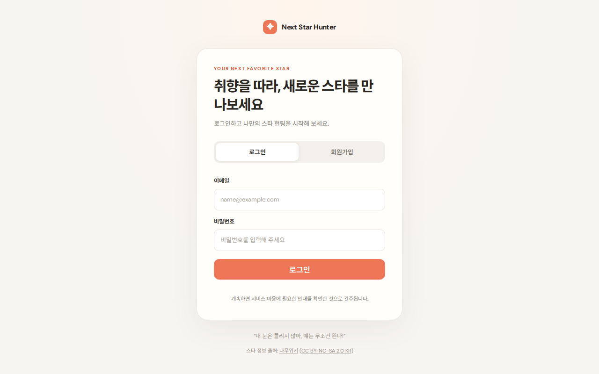
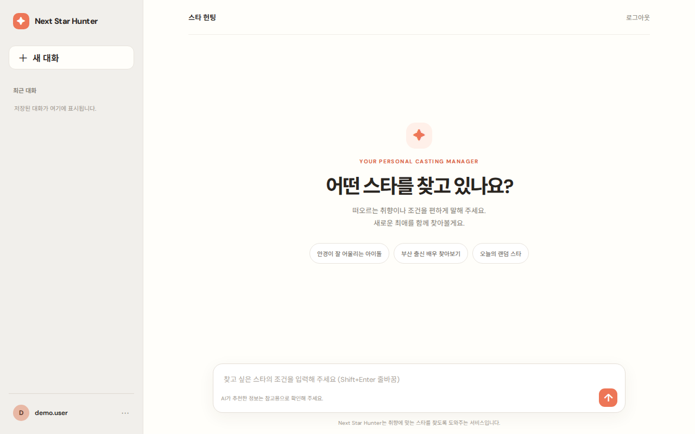
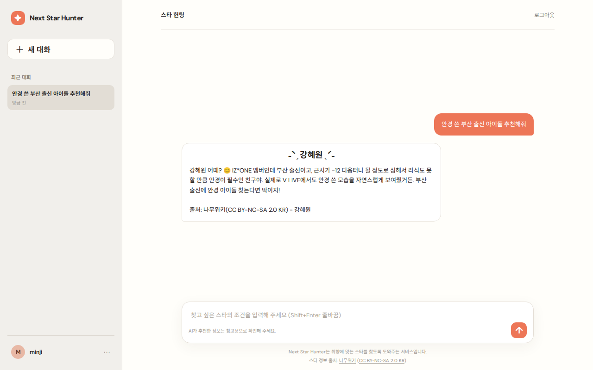
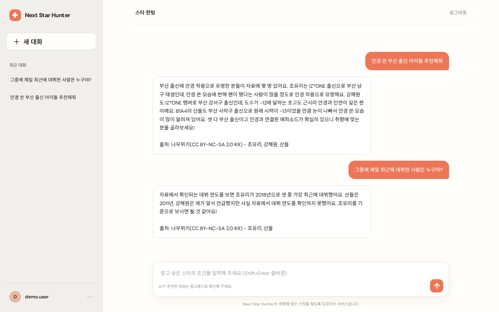
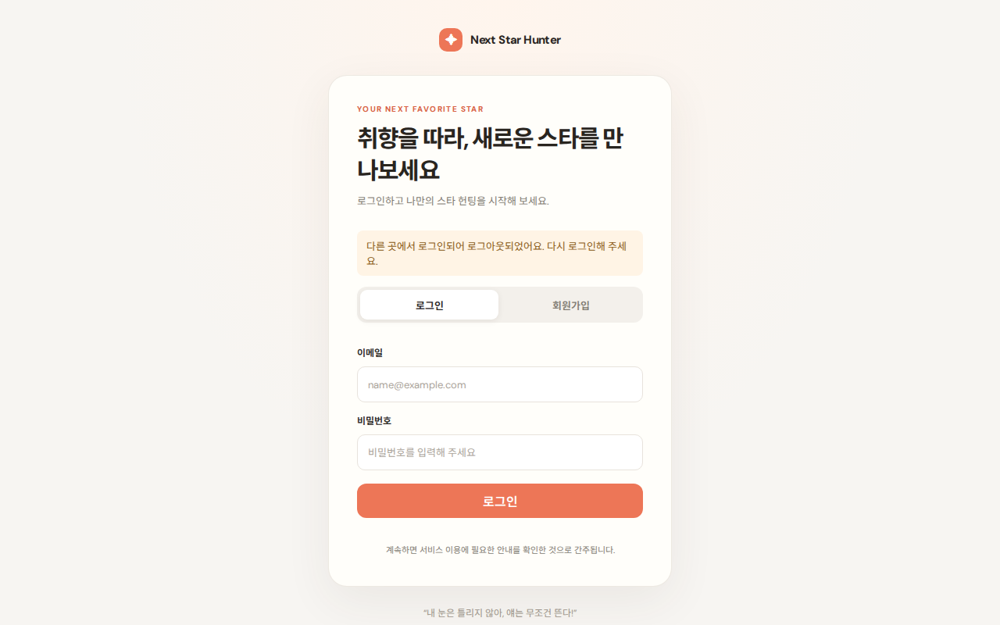
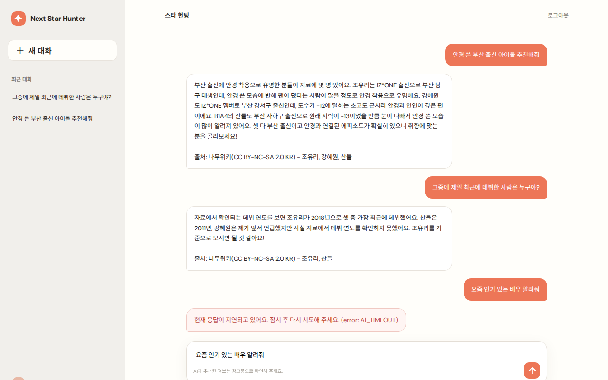
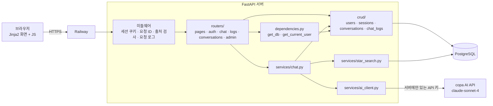
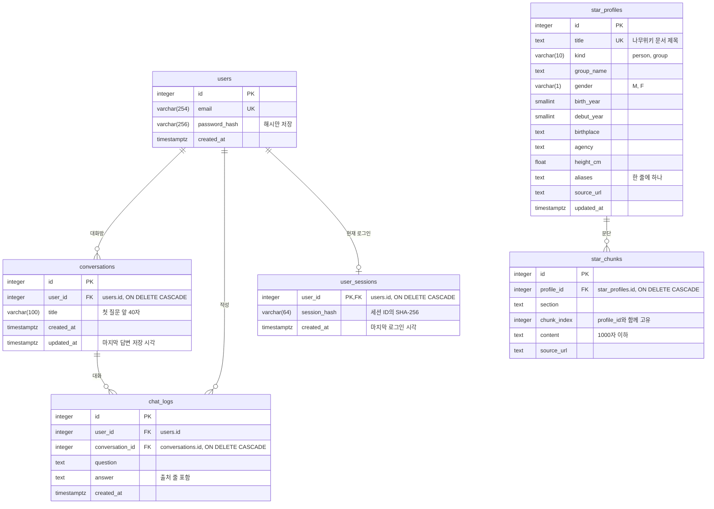

# Next Star Hunter (다음 아이돌 발굴가)

취향과 조건을 말하면 나무위키 자료를 근거로 한국 아이돌·가수·배우를 추천해 주는 웹 AI 챗봇입니다. 로그인한 사용자가 "안경 쓴 부산 출신 아이돌 추천해줘"처럼 질문하면 서버가 스타 자료를 찾아 AI API에 함께 보내고, 받은 답변을 화면에 보여 준 뒤 질문과 답변을 사용자별로 PostgreSQL에 저장합니다. 저장된 최근 대화를 다음 질문에 함께 보내므로 "그중에 제일 최근에 데뷔한 사람은?"처럼 이어서 물어볼 수 있습니다.

서비스 주소: https://next-star-hunter-production.up.railway.app

저장소: https://github.com/innurhap28/Next-Star-Hunter.bot

## 프로젝트 개요

- 문제 정의: 관심 가는 스타를 출신 지역, 데뷔 시기, 그룹, 외모 같은 조건을 섞어 찾고 싶지만, 검색창에 조건을 하나씩 넣어서는 찾기 어렵습니다.
- 대상 사용자: 새로 좋아할 아이돌, 가수, 배우를 취향에 맞춰 찾아보고 싶은 사용자
- 핵심 시나리오: 회원가입, 로그인, 조건으로 질문, 추천과 이유 확인, 앞의 조건을 이어서 후속 질문, 다시 접속해 이전 대화 확인
- 주요 기능: 이메일 회원가입과 로그인, 계정당 로그인 세션 하나, 스타 자료 검색과 한 명 추천(맨 위 이름 표시, 반말 답변), 출처 표시, 최근 대화 5쌍을 이용한 문맥 유지, 내 대화 기록 조회와 삭제, 관리자 계정의 가입자·대화 조회, AI 지연·실패 안내

## 기술 스택

| 구분 | 사용 | 고른 이유 | 아쉬운 점 |
|---|---|---|---|
| 백엔드 | Python 3.9+, FastAPI | 라우터, 의존성 주입, Pydantic 입력 검증이 기본으로 있고 Swagger 문서가 자동으로 만들어집니다 | 동기 DB 세션을 쓰므로 동시 요청이 많아지면 비동기 구성을 다시 봐야 합니다 |
| 화면 | Jinja2 템플릿, Vanilla JS, CSS | API와 화면을 서버 하나로 배포하고 빌드 도구 없이 바로 띄울 수 있습니다 | 화면 상태를 직접 관리해야 해서 화면이 늘면 코드가 길어집니다 |
| DB | PostgreSQL, SQLAlchemy 2.0 | 사용자, 대화 기록, 스타 자료를 한 DB에 두고 인덱스와 쿼리 시간 제한으로 스타 검색을 빠르게 할 수 있습니다 | 마이그레이션 도구 없이 `create_all`로 테이블을 만들어 컬럼 변경은 직접 처리해야 합니다 |
| 인증 | 서명된 세션 쿠키, `user_sessions` 테이블 | 쿠키 하나로 로그인 상태를 유지하고, DB에 저장한 세션과 비교해 계정당 한 곳에서만 로그인되게 합니다 | 로그인이 필요한 요청마다 DB 조회가 한 번 더 생깁니다 |
| AI 연동 | httpx로 서버에서 호출 | API 키가 서버에만 있고, 시간 초과와 오류 종류를 직접 나눠 처리할 수 있습니다. 테스트는 가짜 전송 계층으로 네트워크 없이 돌립니다 | 답변을 한 번에 받기 때문에 긴 답변은 기다리는 시간이 깁니다(스트리밍 없음) |
| AI 모델 | copa `claude-sonnet-4` | 별도 결제 없이 쓸 수 있는 엔드포인트라 기본 모델로 정했습니다. 예비로 `claude-haiku-4`만 허용합니다 | 외부 서비스라 지연과 장애를 우리가 제어할 수 없습니다 |
| 스타 자료 | 나무위키 덤프 | 국내 스타 문서가 많고 인포박스에 출생지, 데뷔, 소속사가 정리돼 있습니다 | 누구나 고칠 수 있는 문서라 틀린 내용이 있을 수 있고, 비영리 라이선스입니다 |
| 배포 | Railway | `main` 병합만으로 자동 배포되고 PostgreSQL을 같은 프로젝트에 붙일 수 있습니다 | 사용량 과금이라 계속 켜 두려면 사용량을 챙겨야 합니다 |
| CI | GitHub Actions | PR마다 `ruff check .`와 `pytest -q`를 돌려 병합 조건으로 씁니다 | 실제 PostgreSQL과 AI를 쓰는 테스트는 CI에서 건너뜁니다 |

## 화면

### 로그인과 회원가입



이메일과 비밀번호(8~128자)로 가입하고 로그인합니다. 가입할 때는 비밀번호 확인란이 같아야 하며(브라우저에서만 확인), 화면 아래에 스타 정보 출처(나무위키, CC BY-NC-SA 2.0 KR)를 표시합니다. 로그인하지 않고 채팅 화면(`/`)에 들어오면 이 화면(`/auth`)으로 이동합니다.

### 채팅



처음 화면에는 추천 질문 버튼이 있습니다. 버튼을 누르면 정해 둔 질문을 그대로 보냅니다. 왼쪽 최근 대화 목록은 저장된 질문을 최신순으로 보여 주고, 새 대화 버튼은 화면만 비웁니다(저장된 기록은 그대로 남습니다).

최근 대화 항목 옆 `×` 버튼은 확인을 거쳐 그 대화를 지웁니다(`DELETE /api/me/chats/{chat_id}`). 사이드바 오른쪽 가장자리를 끌거나(마우스·터치) 포커스한 뒤 방향키로 너비를 200~480px 사이에서 바꿀 수 있고, 바꾼 너비는 브라우저에 기억됩니다(모바일 화면에서는 숨김). 왼쪽 아래 프로필을 누르면 이메일, 로그아웃, 관리자 계정일 때만 `관리자 페이지` 링크가 있는 메뉴가 열립니다. 화면 아래에는 나무위키와 CC BY-NC-SA 2.0 KR 라이선스 링크를 담은 출처 문구가 있습니다.



서버가 질문 속 조건(부산 출신, 아이돌)으로 스타 자료를 찾아 AI에 넘기고, 나머지 단어(안경)는 찾은 스타의 문서 본문에서 찾습니다. 찾은 스타 중 한 명을 무작위로 골라 그 자료만 AI에 넘기고, AI는 친구에게 말하듯 반말로 추천 이유를 설명합니다. 서버가 답변 맨 위에 `˗ˋˏ 이름 ˎˊ˗` 줄을, 마지막 줄에 출처를 붙이고, 화면은 이 이름 줄을 답변 위 가운데에 큰 글씨 제목으로 보여 줍니다(지난 기록도 같습니다).

### 후속 질문(문맥 유지)



"그중에"처럼 조건 없이 이어지는 질문은 같은 사용자의 최근 대화 5쌍을 함께 보내 앞의 추천을 기준으로 답합니다. "그 사람 어떤 그룹이야?"처럼 앞서 추천한 사람을 가리키면 같은 사람으로 답하고, "다른 사람"을 원하면 이미 추천한 사람을 빼고 새로 고릅니다. "오늘의 랜덤 스타"처럼 조건 없이 아무나 원하면 스타 자료에서 한 명을 무작위로 골라 추천합니다. 자료에서 확인되지 않는 내용은 확인하지 못했다고 답합니다.

### 다른 곳 로그인 안내



같은 계정으로 다른 브라우저에서 로그인하면 이전 브라우저의 다음 API 요청이 `401 SESSION_REPLACED`를 받고, 화면이 바로 `/auth?reason=session_replaced`로 이동해 안내 문구를 보여 줍니다. 이전 브라우저에서 페이지를 새로 열어도(`GET /`) 같은 화면으로 이동합니다.

### 관리자 화면

`ADMIN_EMAIL` 계정으로 로그인한 뒤 `/admin`을 열면 가입자 수·전체 대화 수·오늘 대화 수, 사용자 목록(가입일, 대화 수, 마지막 대화)을 볼 수 있습니다. 사용자를 누르면 그 사용자의 질문과 답변이 나오고, "전체 최근 대화 보기"로 모든 사용자의 최근 대화로 돌아갑니다. 일반 사용자가 열면 채팅 화면으로 이동합니다.

### AI 응답 지연 안내



AI가 `LLM_TIMEOUT_SECONDS` 안에 답하지 않으면 `504 AI_TIMEOUT`을 받아 안내 문구와 오류 코드를 표시하고, 보낸 질문을 입력창에 다시 넣어 바로 재전송할 수 있게 합니다. 실패한 질문은 저장하지 않습니다.

## 시스템 구조



화면과 API를 같은 서버가 제공하므로 브라우저는 같은 출처로 요청하고, 로그인 상태는 HttpOnly 세션 쿠키로 주고받습니다. 다른 출처에서 온 브라우저의 쓰기 요청(POST 등)은 미들웨어가 `403 ORIGIN_NOT_ALLOWED`로 막습니다. AI API 키는 서버 환경 변수에만 있고 브라우저로 보내지 않습니다.

### 주요 컴포넌트 역할

| 위치 | 역할 |
|---|---|
| `frontend/templates/`, `frontend/static/` | 로그인·회원가입 화면(`auth.html`, `auth.js`), 채팅 화면(`chat.html`, `chat.js`)과 관리자 화면(`admin.html`, `admin.js`) |
| `backend/app/main.py` | 앱 생성, 세션 쿠키·요청 ID·출처 검사 미들웨어, 공통 오류 응답, `/health`, 라우터 등록 |
| `backend/app/routers/` | URL과 요청·응답 스키마 연결. `pages.py`(화면), `auth.py`(계정), `chat.py`(채팅), `logs.py`(대화 기록 조회·삭제), `conversations.py`(대화방 목록·조회·삭제), `admin.py`(관리자 조회) |
| `backend/app/services/` | 채팅 흐름(최근 문맥 → 스타 검색 → AI 호출 → 출처 줄 → 저장), AI API 호출과 오류 변환, 스타 자료 검색 |
| `backend/app/crud/` | DB 조회와 저장. 라우터와 서비스는 쿼리를 직접 쓰지 않고 이 함수를 부릅니다 |
| `backend/app/schemas/` | Pydantic 요청·응답 모델. 입력 길이와 형식 검사 |
| `backend/app/dependencies.py` | 요청마다 DB 세션을 열고, 쿠키의 세션을 `user_sessions`와 비교해 로그인 사용자를 확인 |
| `backend/app/security.py` | 비밀번호 해시(scrypt, 없으면 PBKDF2)와 검증 |
| `scripts/namuwiki/` | 나무위키 덤프에서 스타 문서를 추출, 정제, 청킹해 스타 테이블에 적재 |

```text
backend/
├── app/
│   ├── main.py             # 앱 생성, 미들웨어, 공통 오류 처리, /health
│   ├── config.py           # 환경 변수 (Settings)
│   ├── logging_config.py   # 콘솔 로그 형식, LOG_FILE_PATH 파일 로그
│   ├── database.py         # DB 엔진·세션 생성
│   ├── models.py           # users, user_sessions, conversations, chat_logs, star_profiles, star_chunks
│   ├── dependencies.py     # get_db, get_current_user
│   ├── security.py         # 비밀번호 해시·검증
│   ├── openapi_errors.py   # Swagger 오류 응답 예시
│   ├── init_db.py          # 테이블 생성 (python -m app.init_db)
│   ├── routers/            # auth.py, chat.py, logs.py, conversations.py, admin.py, pages.py
│   ├── services/           # chat.py, ai_client.py, star_search.py
│   ├── crud/               # users.py, sessions.py, conversations.py, chat_logs.py
│   └── schemas/            # auth.py, chat.py, logs.py, admin.py, errors.py
├── check_local.py          # 로컬 설정·DB 연결 점검 (값은 출력하지 않음)
└── local_postgres.py       # Windows 로컬 PostgreSQL 준비
```

계층별 설명과 질문 처리 순서는 [docs/ARCHITECTURE.md](docs/ARCHITECTURE.md)에 있습니다.

## DB 구조



- `users`: 로그인 계정입니다. 이메일은 소문자로 바꿔 저장하고, 비밀번호는 솔트를 넣은 해시만 저장합니다.
- `user_sessions`: 계정마다 지금 유효한 로그인 하나입니다. 로그인할 때마다 행을 덮어쓰므로 이전 브라우저의 세션은 끊깁니다. 세션 ID 원문은 쿠키에만 있고 DB에는 해시만 둡니다.
- `conversations`: 대화방입니다. 채팅 문맥과 후속 질문의 앞 스타는 같은 대화방 안에서만 씁니다. `(user_id, updated_at)` 인덱스로 최근 대화방 목록을 찾습니다.
- `chat_logs`: 질문과 답변 한 쌍이 한 행이고 대화방 하나에 속합니다. `(user_id, created_at, id)` 인덱스로 사용자별 최근 기록을 찾습니다. AI 답변을 받은 경우에만 저장합니다.
- `star_profiles`, `star_chunks`: 나무위키에서 가져온 스타 프로필과 본문 조각입니다. 사용자 데이터와 연결하지 않으며 앱이 아니라 적재 스크립트가 채웁니다.

필드별 설명과 인덱스는 [docs/DATABASE.md](docs/DATABASE.md)에 있습니다.

## API

요청·응답 예시와 엔드포인트별 오류는 [docs/API.md](docs/API.md)에 있고, 요청·응답 스키마는 Swagger UI(https://next-star-hunter-production.up.railway.app/docs)에서 확인할 수 있습니다. Swagger UI에서 `POST /api/auth/login`을 실행하면 이후 요청을 로그인 상태로 시험할 수 있습니다. Swagger UI는 `ENABLE_API_DOCS=true`일 때만 열립니다.

| 메서드 | 경로 | 로그인 | 설명 |
|---|---|---|---|
| GET | `/health` | | 서버 상태 확인 (DB·AI 설정과 무관) |
| GET | `/` | 필요 (아니면 `/auth`로 이동) | 채팅 화면 |
| GET | `/auth` | | 로그인·회원가입 화면 (로그인 상태면 `/`로 이동) |
| GET | `/admin` | 관리자 | 관리자 화면 (아니면 `/auth` 또는 `/`로 이동) |
| POST | `/api/auth/register` | | 회원가입 |
| POST | `/api/auth/login` | | 로그인, 세션 쿠키 발급, 이전 세션 교체 |
| POST | `/api/auth/logout` | 필요 | 로그아웃 |
| GET | `/api/me` | 필요 | 내 계정 정보 |
| POST | `/api/chat` | 필요 | 질문 전송, AI 답변 반환, 대화 저장 |
| GET | `/api/me/chats` | 필요 | 내 대화 기록 (`limit` 1~100, 기본 20) |
| DELETE | `/api/me/chats/{chat_id}` | 필요 | 내 대화 한 건 삭제 (방이 비면 방도 삭제) |
| GET | `/api/me/conversations` | 필요 | 내 대화방 목록, 최근 순 (`limit` 1~100, 기본 50) |
| GET | `/api/me/conversations/{conversation_id}/chats` | 필요 | 대화방 하나의 대화 전체, 오래된 순 |
| DELETE | `/api/me/conversations/{conversation_id}` | 필요 | 대화방과 그 안의 대화 삭제 |

로그인하면 `next_star_session` 쿠키(HttpOnly, SameSite=Lax, 8시간)가 발급되고, 로그인이 필요한 API는 이 쿠키로 사용자를 확인합니다. 오류는 모두 `{"error": "코드", "message": "안내 문구"}` 형식이며, 모든 응답에 요청 ID가 `X-Request-ID` 헤더로 붙습니다.

## 대화 로그 저장과 조회

질문과 답변을 DB에 저장하는 이유는 다음과 같습니다.

- 문맥 유지: 서버 메모리에 대화를 들고 있지 않고, 질문이 올 때마다 같은 대화방의 최근 5쌍을 `chat_logs`에서 읽어 AI에 함께 보냅니다. `POST /api/chat`에 `conversation_id`를 빼면 새 대화방이 만들어집니다. 서버를 다시 시작해도 대화를 이어갈 수 있습니다.
- 기록 확인: 다시 접속하면 채팅 화면이 `GET /api/me/chats`로 최근 대화를 불러옵니다. 조회는 로그인한 사용자 ID로만 하므로 다른 사람의 기록은 보이지 않습니다.
- 추적과 개선: 이상한 추천이 나온 대화를 사용자와 시각으로 찾아 어떤 질문에서 나왔는지 보고, 검색 조건과 프롬프트를 고치는 근거로 씁니다.

AI 호출이 실패한 질문은 저장하지 않습니다. AI 답변은 받았지만 저장에 실패하면 답변은 그대로 보여 주고 응답의 `saved`를 `false`로 보내며, 화면에 "이 대화는 저장되지 않았어요." 안내를 붙입니다.

### SQL로 확인하기

`scripts/check_logs.sql`에는 사용자별 대화 수와 마지막 대화 시각, 그리고 한 사용자의 최근 20건(질문과 답변은 앞 50자)을 조회하는 쿼리가 있습니다. `psql`은 `postgresql://` 주소를 받으므로 `DATABASE_URL`이 `postgresql+psycopg://`로 시작하면 `+psycopg`를 빼고 넣습니다. 운영 DB는 Railway PostgreSQL의 연결 정보로 접속합니다.

```bash
psql "postgresql://<사용자>:<비밀번호>@<호스트>:<포트>/<DB>" -v email='demo.user@example.com' -f scripts/check_logs.sql
```

화면 캡처의 두 질문이 저장된 시연용 DB에서 위 명령을 실행한 실제 출력입니다. 첫 번째는 사용자별 대화 수, 두 번째는 지정한 사용자의 최근 기록(질문·답변 앞 50자)입니다.

```
 user_id |         email         | chat_count |         last_chat_at
---------+-----------------------+------------+-------------------------------
       1 | demo.user@example.com |          2 | 2026-10-29 22:52:15.292162+00
(1 row)

 id |          created_at           |                 question                 |                                        answer
----+-------------------------------+------------------------------------------+--------------------------------------------------------------------------------------
  2 | 2026-10-29 22:52:15.292162+00 | 그중에 제일 최근에 데뷔한 사람은 누구야? | 자료에서 확인되는 데뷔 연도를 보면 조유리가 2018년으로 셋 중 가장 최근에 데뷔했어요.
  1 | 2026-10-29 22:52:10.866235+00 | 안경 쓴 부산 출신 아이돌 추천해줘        | 부산 출신에 안경 착용으로 유명한 분들이 자료에 몇 명 있어요. 조유리는 IZ*ONE 출신
(2 rows)
```

### API로 확인하기

로그인 응답으로 받은 세션 쿠키를 저장해 두고, 그 쿠키로 내 대화 기록을 조회합니다. `limit`(1~100, 기본 20)만큼 최신 기록을 가져와 오래된 순서로 돌려줍니다.

```bash
BASE=https://next-star-hunter-production.up.railway.app
curl -s -c cookies.txt -H 'Content-Type: application/json' \
  -d '{"email":"<이메일>","password":"<비밀번호>"}' "$BASE/api/auth/login"
curl -s -b cookies.txt "$BASE/api/me/chats?limit=2"
```

응답 예시입니다. 긴 답변은 줄였습니다.

```json
{
  "items": [
    {
      "id": 1,
      "question": "안경 쓴 부산 출신 아이돌 추천해줘",
      "answer": "부산 출신에 안경 착용으로 유명한 분들이 자료에 몇 명 있어요. 조유리는 IZ*ONE 출신으로 부산 남구 태생인데, (생략)\n\n출처: 나무위키(CC BY-NC-SA 2.0 KR) - 조유리, 강혜원, 산들",
      "created_at": "2026-10-30T07:41:15.917402Z"
    },
    {
      "id": 2,
      "question": "그중에 제일 최근에 데뷔한 사람은 누구야?",
      "answer": "자료에서 확인되는 데뷔 연도를 보면 조유리가 2018년으로 셋 중 가장 최근에 데뷔했어요. (생략)\n\n출처: 나무위키(CC BY-NC-SA 2.0 KR) - 조유리, 산들",
      "created_at": "2026-10-30T07:42:19.508113Z"
    }
  ]
}
```

쿠키 없이 호출하면 `401 {"error": "LOGIN_REQUIRED", "message": "로그인이 필요합니다."}`를 받습니다.

## 서버 로그와 오류 추적

서버는 이벤트 이름 뒤에 `key=value` 필드를 붙인 한 줄 로그를 표준 출력에 남깁니다. Railway에서는 Deploy Logs에서 보고, `LOG_FILE_PATH`를 지정하면 같은 형식으로 파일에도 남깁니다. 질문과 답변 내용, 비밀번호, API 키는 로그에 남기지 않습니다.

| 이벤트 | 남는 때 | 주요 필드 |
|---|---|---|
| `request_received` | 모든 요청 수신 | `method`, `path`, `request_id` |
| `login_success` | 로그인 성공 | `user_id`, `request_id` |
| `session_replaced` | 다른 곳의 로그인으로 끊긴 세션의 요청 | `user_id`, `request_id` |
| `chat_deleted` | 내 대화 한 건 삭제 | `user_id`, `chat_id`, `request_id` |
| `admin_view` | 관리자 API 조회 (조회한 데이터는 남기지 않음) | `user_id`, `path`, `request_id` |
| `star_search_done` | 스타 자료 검색 완료 | `request_id`, `hits`, `latency_ms` |
| `star_search_failure` | 스타 자료 검색 실패 (채팅은 참고 자료 없이 계속) | `request_id`, `error_type` |
| `ai_call_start` | AI API 호출 직전 | `user_id`, `request_id` |
| `ai_call_success` | AI 답변 수신 | `request_id`, `latency_ms` |
| `ai_call_failure` | AI 시간 초과, 오류 응답, 연결 실패, 설정 누락 | `request_id`, `error`, `reason` |
| `db_save_success` | 회원가입(`action=register`), 대화 저장 | `user_id`, `chat_id`, `request_id` |
| `db_save_failure` | 대화 저장 실패 (답변은 `saved: false`로 반환) | `user_id`, `request_id`, `error_type` |
| `db_operation_failure` | 그 밖의 DB 오류 (`503 DB_UNAVAILABLE`) | `request_id`, `error_type` |
| `star_search_fallback_timeout` | 드문 단어의 전체 조각 검색이 제한 시간(150ms)을 넘겨 못 찾은 것으로 처리 | 없음 |
| `log_file_open_failure` | `LOG_FILE_PATH` 파일을 열지 못해 파일 로그 없이 표준 출력만 사용 (서버는 계속 실행) | `path`, `error_type` |

`request_id`는 요청마다 만드는 UUID이고 응답 헤더 `X-Request-ID`로도 돌려줍니다. 요청에 UUID 형식의 `X-Request-ID`를 보내면 그 값을 그대로 씁니다. 사용자가 겪은 오류의 요청 ID로 같은 요청의 로그를 모두 찾을 수 있고, `db_save_success`의 `chat_id`는 `chat_logs.id`라서 서버 로그와 DB 행을 연결할 수 있습니다.

### 오류 응답

| 상태 | `error` | 상황 | 채팅 화면 안내 |
|---|---|---|---|
| 401 | `LOGIN_REQUIRED` | 로그인하지 않았거나 세션이 만료됨 | 로그인 화면으로 이동 |
| 401 | `SESSION_REPLACED` | 같은 계정이 다른 곳에서 로그인함 | 로그인 화면으로 이동해 안내 표시 |
| 422 | `VALIDATION_ERROR` | 빈 질문, 1000자 초과, 알 수 없는 필드 | 질문은 공백을 제외하고 1자 이상 1000자 이하로 입력해 주세요. |
| 502 | `AI_ERROR` | AI API 오류 응답, 연결 실패, 빈 응답, 응답 형식 오류 | AI 답변을 받지 못했어요. 잠시 후 다시 시도해 주세요. |
| 503 | `AI_NOT_CONFIGURED` | 서버에 `LLM_API_KEY`가 없음 | AI 연결 설정이 아직 준비되지 않았어요. 관리자에게 알려 주세요. |
| 503 | `DB_UNAVAILABLE` | 최근 대화 조회 등 DB 요청 실패 | 서버 저장소에 연결할 수 없어요. 잠시 후 다시 시도해 주세요. |
| 504 | `AI_TIMEOUT` | AI가 `LLM_TIMEOUT_SECONDS`(기본 90초) 안에 답하지 않음 | 현재 응답이 지연되고 있어요. 잠시 후 다시 시도해 주세요. |

AI 서버가 보낸 오류 본문은 사용자에게 넘기지 않고 정해진 코드와 문구만 보냅니다. 화면은 안내 문구 뒤에 `(error: AI_TIMEOUT)`처럼 오류 코드를 함께 표시합니다. 계정 API의 오류(`EMAIL_EXISTS`, `INVALID_CREDENTIALS`, `ORIGIN_NOT_ALLOWED`, `AUTH_NOT_CONFIGURED`, `DB_NOT_CONFIGURED`)는 [docs/API.md](docs/API.md#오류-응답)에 있습니다.

아래는 `LOG_FILE_PATH`를 지정하지 않고 로컬에서 서버를 실행했을 때 표준 출력에 남은 로그의 일부(로컬 실행 로그 일부)입니다. 정적 파일 요청 같은 관련 없는 줄은 뺐고 나머지는 그대로입니다. 요청 ID와 시각, 소요 시간은 실행마다 다릅니다.

### 정상 응답

질문 하나의 `request_id`로 그 요청의 로그만 골라 본 것입니다. 로그 파일을 쓸 때는 `grep <request_id> logs/app.log`로 같은 결과를 얻습니다.

```
2026-10-30 07:52:03,543 INFO next_star_hunter request_received method=POST path=/api/chat request_id=e127d77f-839f-42c7-96cb-08f3ae01dfab
2026-10-30 07:52:03,605 INFO next_star_hunter star_search_done request_id=e127d77f-839f-42c7-96cb-08f3ae01dfab hits=5 latency_ms=54
2026-10-30 07:52:03,605 INFO next_star_hunter ai_call_start user_id=1 request_id=e127d77f-839f-42c7-96cb-08f3ae01dfab
2026-10-30 07:52:10,865 INFO next_star_hunter ai_call_success request_id=e127d77f-839f-42c7-96cb-08f3ae01dfab latency_ms=7260
2026-10-30 07:52:10,870 INFO next_star_hunter db_save_success user_id=1 chat_id=1 request_id=e127d77f-839f-42c7-96cb-08f3ae01dfab
```

### 타임아웃

AI 서버에 연결하지 못하고 시간이 초과되어 `504 AI_TIMEOUT`을 돌려준 요청입니다. 질문은 저장하지 않으므로 `db_save_success`가 없습니다.

```
2026-10-30 07:52:18,618 INFO next_star_hunter request_received method=POST path=/api/chat request_id=1a1d97e2-dc97-4176-9a65-20f40433e703
2026-10-30 07:52:18,675 INFO next_star_hunter star_search_done request_id=1a1d97e2-dc97-4176-9a65-20f40433e703 hits=5 latency_ms=52
2026-10-30 07:52:18,676 INFO next_star_hunter ai_call_start user_id=1 request_id=1a1d97e2-dc97-4176-9a65-20f40433e703
2026-10-30 07:52:18,704 WARNING next_star_hunter ai_call_failure request_id=1a1d97e2-dc97-4176-9a65-20f40433e703 error=AI_TIMEOUT reason=ConnectTimeout
```

AI가 연결은 됐지만 `LLM_TIMEOUT_SECONDS` 안에 답하지 않으면 `reason=ReadTimeout`이 남습니다. AI 서버가 오류로 응답하면 같은 자리에 `error=AI_ERROR reason=http_500`처럼 상태 코드가, 연결에 실패하면 `reason=ConnectError`처럼 예외 이름이 남습니다.

### 세션 교체

같은 계정으로 다시 로그인한 뒤 이전 세션으로 화면(`GET /`)을 요청한 경우입니다. 화면 요청은 `/auth?reason=session_replaced`로 이동하고, API 요청은 `401 SESSION_REPLACED`를 받습니다.

```
2026-10-30 07:52:16,180 INFO next_star_hunter request_received method=POST path=/api/auth/login request_id=0e76ba6f-a658-4881-8103-4ac6808cb229
2026-10-30 07:52:16,231 INFO next_star_hunter login_success user_id=1 request_id=0e76ba6f-a658-4881-8103-4ac6808cb229
2026-10-30 07:52:16,238 INFO next_star_hunter request_received method=GET path=/ request_id=91d48e60-3262-410a-971a-982f2f1a8491
2026-10-30 07:52:16,240 INFO next_star_hunter session_replaced user_id=1 request_id=91d48e60-3262-410a-971a-982f2f1a8491
2026-10-30 07:52:16,243 INFO next_star_hunter request_received method=GET path=/auth request_id=2641e2ef-d2f1-4c74-80ff-6c54a3747ef2
```

## 스타 자료(나무위키)

- 나무위키 덤프에서 한국 아이돌, 가수, 배우, 그룹 문서를 분류 기준으로 골라 평문으로 정제하고, 프로필 항목(성별, 출생연도, 데뷔연도, 출생지, 소속사, 소속 그룹, 키)과 1000자 이하 본문 조각으로 나눠 `star_profiles`, `star_chunks`에 적재합니다. 전체 덤프 기준 스타 20,692건, 조각 179,464건입니다.
- 채팅은 질문에서 지역, 성별, 데뷔·출생 연도, 그룹·스타 이름 같은 조건을 규칙으로 뽑아 최대 5명을 찾고, 발췌문을 `<참고자료>` 블록으로 AI에 넘깁니다. 자료가 없거나 검색이 실패해도 채팅은 참고 자료 없이 동작합니다.
- 나무위키 문서의 라이선스는 **CC BY-NC-SA 2.0 KR**(저작자 표시, 비영리, 동일조건 변경허락)입니다. 이 서비스는 비영리로만 사용하고, 자료를 쓴 답변 끝에 `출처: 나무위키(CC BY-NC-SA 2.0 KR) - 문서 이름` 줄을 붙이며, 문서별 원문 주소를 `source_url`에 저장합니다.
- 원본 덤프와 추출 결과는 저장소에 올리지 않습니다.

추출·정제·적재 방법과 검색 규칙, 적재 결과는 [docs/DATA.md](docs/DATA.md)에 있습니다.

## 실행 방법

Python 3.9 이상과 PostgreSQL이 필요합니다. 저장소 루트에서 실행합니다.

```bash
git clone https://github.com/innurhap28/Next-Star-Hunter.bot.git
cd Next-Star-Hunter.bot
python3 -m venv .venv
source .venv/bin/activate              # Windows PowerShell: .\.venv\Scripts\Activate.ps1
python -m pip install -r requirements.txt
cp .env.example .env                   # SECRET_KEY, DATABASE_URL, LLM_API_KEY 입력
PYTHONPATH=backend python -m app.init_db
python -m uvicorn app.main:app --reload --app-dir backend
```

Windows PowerShell에서는 `Copy-Item .env.example .env`, `$env:PYTHONPATH = "backend"; python -m app.init_db`로 바꿔 실행합니다. 가상환경 활성화가 실행 정책에 막히면 `Set-ExecutionPolicy -Scope Process -ExecutionPolicy Bypass`를 먼저 실행합니다.

- 브라우저에서 `http://127.0.0.1:8000/`을 엽니다. 로그인하지 않았으면 `/auth`로 이동합니다.
- `curl http://127.0.0.1:8000/health` → `{"status":"ok","service":"next-star-hunter"}`
- 설정과 DB 연결은 `python backend/check_local.py`로 점검합니다.
- 스타 자료를 적재하지 않아도 채팅은 참고 자료 없이 동작합니다. 적재 방법은 [docs/DATA.md](docs/DATA.md)에 있습니다.
- 테스트: `pip install -r requirements-dev.txt` 후 `ruff check .`, `pytest -q` (네트워크, AI 키, 실제 DB 없이 실행)

### 환경 변수

`.env.example`을 `.env`로 복사해 씁니다. `.env`는 `.gitignore`에 들어 있어 커밋되지 않습니다.

| 이름 | 필수 | 설명 | 기본값 |
|---|---|---|---|
| `SECRET_KEY` | 필수 | 세션 쿠키 서명 키. 32자 이상이어야 계정 API가 동작합니다 | |
| `DATABASE_URL` | 필수 | PostgreSQL 주소. `postgres://`, `postgresql://`, `postgresql+psycopg://` 모두 받습니다 | |
| `LLM_API_KEY` | 채팅에 필수 | AI API 키. 서버에서만 씁니다 | |
| `LLM_BASE_URL` | 선택 | AI API 주소 | `https://copa.codyssey.kr/v1` |
| `LLM_API_STYLE` | 선택 | 요청 형식 `anthropic` 또는 `openai` | `anthropic` |
| `LLM_MODEL` | 선택 | `claude-sonnet-4` 또는 `claude-haiku-4` | `claude-sonnet-4` |
| `LLM_TIMEOUT_SECONDS` | 선택 | AI 호출 시간 제한(초) | `90` |
| `LLM_MAX_COMPLETION_TOKENS` | 선택 | 응답 최대 토큰 수 | `8000` |
| `SESSION_HTTPS_ONLY` | 선택 | 세션 쿠키를 HTTPS에서만 보냄. 운영은 `true` | `false` |
| `ENABLE_API_DOCS` | 선택 | `/docs`(Swagger UI), `/openapi.json` 노출 | `false` |
| `LOG_FILE_PATH` | 선택 | 앱 로그를 이 파일에도 기록. 열 수 없으면 경고만 남기고 콘솔 로그는 계속 | 없음 |
| `ADMIN_EMAIL` | 선택 | 관리자 계정 이메일. 이 이메일로 로그인하면 관리자 API를 쓸 수 있습니다(대소문자 무시). 이 이메일로는 회원가입할 수 없고 `init_db`로만 만들어집니다. 이미 있는 계정을 지정하면 운영자 본인 계정인지 먼저 확인하세요. 비우면 관리자 없음 | 없음 |
| `ADMIN_PASSWORD` | 선택 | 관리자 계정 비밀번호(8자 이상). `init_db`가 계정이 없을 때만 이 값으로 만들고, 있는 계정의 비밀번호는 바꾸지 않습니다 | 없음 |

`SECRET_KEY`나 `DATABASE_URL`이 없어도 서버는 뜨고 `/health`는 응답합니다. 이때 계정·채팅 API는 `503 AUTH_NOT_CONFIGURED`, `LLM_API_KEY`가 없으면 채팅만 `503 AI_NOT_CONFIGURED`로 응답합니다.

### 배포

Railway가 `main` 브랜치를 자동 배포하고 같은 프로젝트의 PostgreSQL을 씁니다. 배포 전에 Pre-deploy Command로 테이블을 만들고, `/health`로 헬스체크합니다. 서비스 설정, 운영 환경 변수, 스타 자료 적재, 롤백 절차는 [docs/DEPLOY.md](docs/DEPLOY.md)에 있습니다.

## 팀 구성과 역할

| 이름 | GitHub | 역할 |
|---|---|---|
| 김시현 (팀장) | innurhap28 | 기획, 프론트엔드, 문서, CI, 나무위키 추출 |
| 황승재 | bidulgiya999 | 백엔드(인증, 채팅, AI 연동), DB, 스타 자료 적재·검색, 배포 |

두 사람이 서로의 PR을 리뷰하고 승인한 뒤 병합했습니다.

### 개인별 작업 요약

- 김시현: 저장소와 FastAPI 초기 구성(`/health`), 로그인·회원가입·채팅 화면(#5), 페이지 라우트와 `/static` 연결(#28), 채팅 화면을 채팅·대화 기록 API에 연결하고 오류 코드 안내(#32), 다른 곳 로그인 안내 표시(#43), 나무위키 덤프 스트리밍 리더와 스타 문서 추출 CLI(#31), CI(`lint`, `test`)와 ruff·pytest 설정, PR 템플릿, 라벨·머지 규칙 문서(#12), 린트 정리와 테스트 폴더 통합(#36), Railway 배포 런북과 배포 후 스모크 검사(#14), README와 API·아키텍처·DB·협업 문서(#1, #17), 화면 캡처
- 황승재: PostgreSQL 연결, 사용자·대화 모델, 회원가입·로그인 API(#4), Swagger 응답 예시와 오류 명세, 로컬 PostgreSQL 준비(#6, #8, #23), 비밀번호 해시 호환(#18), AI 설정(#19), AI 호출 모듈과 `POST /api/chat`(#29), `GET /api/me/chats`와 `check_logs.sql`(#30), 나무마크 정제·청킹·스타 테이블 적재(#33), 채팅 스타 검색과 출처 표시(#35), crud 계층 분리(#41), 계정당 세션 하나와 `user_sessions`(#42), services·schemas 계층 분리와 파일 로그(#45), 출처 줄 정리(#46), 관리자 계정·조회 API와 대화 삭제 API(#51), 이슈 폼과 라벨 자동화(#12), Railway 프로젝트 구성과 배포

영역별로 나눈 표는 [docs/CONTRIBUTORS.md](docs/CONTRIBUTORS.md)에 있습니다.

## 브랜치 전략

- `main`: 배포 브랜치. Railway가 이 브랜치를 자동 배포하며, `develop`에서 릴리스 PR로만 반영합니다.
- `develop`: 통합 브랜치이자 저장소 기본 브랜치. 모든 작업 브랜치는 PR로 여기에 병합합니다.
- 작업 브랜치: `frontend/<주제>`, `backend/<주제>`, `data/<주제>`, `chore/<주제>`. 문서는 `docs/setup-all`에서 모아 작업합니다.
- 병합 조건(`main`, `develop` 공통): 상대 팀원 승인 1개(자기 승인 불가), CI `lint`(`ruff check .`)와 `test`(`pytest -q`) 통과, 리뷰 대화 해결, 머지 커밋만 허용. 직접 push와 force push는 막혀 있습니다.
- 커밋 메시지는 `feat: 대화 화면 입력 폼 추가`처럼 `<type>: <내용>` 형식으로 씁니다.

라벨, PR 템플릿, 자세한 규칙은 [docs/CONVENTIONS.md](docs/CONVENTIONS.md)에 있습니다.
