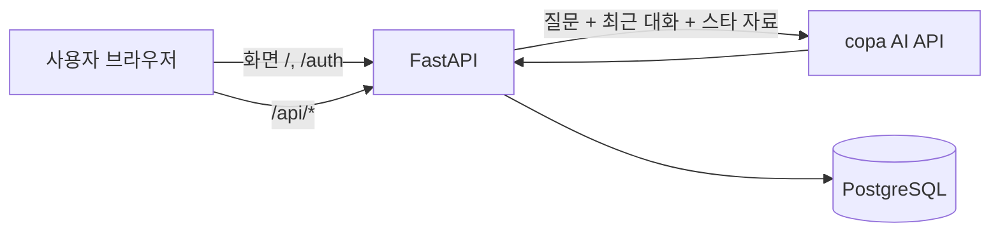

# 시스템 아키텍처

## 전체 흐름



화면(`frontend/`)과 API(`backend/`)를 FastAPI 서버 하나가 함께 제공합니다. 브라우저는 같은 출처로 요청하고, 서버가 로그인과 입력을 확인한 뒤 PostgreSQL과 AI API를 사용합니다. AI API 키는 서버 환경 변수로만 관리합니다. 운영은 Railway에서 서버와 PostgreSQL을 함께 띄웁니다([DEPLOY.md](DEPLOY.md)).

## 주요 컴포넌트

| 컴포넌트 | 역할 |
| --- | --- |
| 화면 (Jinja2 + JS) | 로그인·회원가입, 질문 입력, 답변과 최근 대화 표시, 오류 안내 |
| FastAPI | 요청 처리, 로그인·세션 확인, 입력 검증, 스타 검색, AI 호출, 대화 저장, 요청 로그 |
| AI API | 시스템 프롬프트, 스타 참고 자료, 최근 대화를 바탕으로 답변 생성 |
| PostgreSQL | 사용자, 로그인 세션, 대화 기록, 나무위키 스타 자료 |

## 프로젝트 구조

```text
backend/app/
├── main.py             # 앱 생성, 미들웨어(세션·요청 로그), 예외 처리, 라우터 등록
├── config.py           # 환경 변수 설정 (Settings)
├── logging_config.py   # 콘솔 로그 형식, LOG_FILE_PATH 파일 로그
├── database.py         # DB 엔진·세션 생성
├── models.py           # SQLAlchemy 테이블 (users, user_sessions, chat_logs, star_profiles, star_chunks)
├── dependencies.py     # get_db, get_current_user (로그인·세션 일치 확인 공통 의존성)
├── security.py         # 비밀번호 해시·검증
├── openapi_errors.py   # Swagger 에 보일 오류 응답 예시
├── init_db.py          # 테이블 생성 스크립트 (python -m app.init_db)
├── routers/            # HTTP 경로: auth.py(계정), chat.py(채팅), logs.py(대화 기록 조회·삭제), admin.py(관리자 조회), pages.py(화면)
├── services/           # 업무 흐름: chat.py(채팅 처리), ai_client.py(AI API 호출), star_search.py(스타 자료 검색)
├── crud/               # DB 접근 함수: users.py, sessions.py, chat_logs.py
└── schemas/            # 요청·응답 Pydantic 스키마: auth.py, chat.py, logs.py, admin.py, errors.py
```

계층마다 맡는 일은 다음과 같습니다.

| 계층 | 맡는 일 |
| --- | --- |
| `routers/` | 경로와 요청·응답 스키마 선언, 의존성 주입(`get_db`, `get_current_user`), 서비스의 오류를 HTTP 응답으로 바꾸기 |
| `services/` | 업무 흐름. 채팅은 최근 문맥 조회 → 스타 자료 검색 → AI 호출 → 출처 줄 붙이기 → 저장 순서로 진행하고, AI 실패는 `AIError` 로 올립니다 |
| `crud/` | 쿼리와 저장(commit/rollback). 회원가입은 `get_user_by_email`, `create_user`, 채팅은 `recent_chat_pairs`, `save_chat_log`, 기록 조회는 `list_user_chats` |
| `schemas/` | API 입출력 형식(Pydantic). `schemas/__init__.py` 가 모든 이름을 다시 내보내므로 `from app.schemas import ChatRequest` 처럼 써도 됩니다 |
| `models.py` | DB 테이블 정의(SQLAlchemy) |
| `dependencies.py` | 요청마다 쓰는 DB 세션과 로그인 사용자 확인 |

계정 API(`routers/auth.py`), 대화 기록 조회·삭제(`routers/logs.py`), 관리자 조회(`routers/admin.py`)는 흐름이 짧아 라우터가 `crud/` 를 바로 부릅니다. 관리자 API는 `dependencies.require_admin` 이 로그인 확인 뒤 이메일을 `ADMIN_EMAIL` 과 비교해 아니면 403 `ADMIN_REQUIRED` 로 막습니다. 스타 데이터 검색 쿼리는 검색 로직과 붙어 있어 `services/star_search.py` 에 그대로 둡니다. 로그 이벤트 이름(`ai_call_start`, `db_save_success` 등)은 서비스로 옮긴 뒤에도 같습니다.

## 질문 처리 흐름

1. 미들웨어가 요청 ID를 정하고 `request_received`를 남긴 뒤, 브라우저의 쓰기 요청이면 출처(`Origin`)를 확인합니다.
2. `get_current_user`가 쿠키의 세션을 `user_sessions`와 비교합니다. 로그인하지 않았으면 `401 LOGIN_REQUIRED`, 다른 곳에서 로그인했으면 `401 SESSION_REPLACED`입니다.
3. `ChatRequest`가 질문을 검사합니다(앞뒤 공백 제거 후 1~1000자, 다른 필드 거부).
4. `services/chat.py`가 같은 사용자의 최근 5쌍을 읽고, 스타 자료를 검색한 뒤(`star_search_done`), AI API를 호출합니다(`ai_call_start`, `ai_call_success`).
5. 답변에 출처 줄을 붙여 `chat_logs`에 저장하고(`db_save_success`) 응답합니다.

실패하면 다음과 같이 처리합니다.

| 실패 | 처리 |
| --- | --- |
| 스타 검색 오류, 결과 없음 | 오류면 `star_search_failure`, 결과가 없으면 `star_search_done ... hits=0`을 남기고 참고 자료 없이 계속 |
| AI 시간 초과, 오류 응답, 연결 실패 | `ai_call_failure`를 남기고 `504 AI_TIMEOUT` 또는 `502 AI_ERROR`(`LLM_API_KEY`가 없으면 `503 AI_NOT_CONFIGURED`). 질문은 저장하지 않음 |
| 답변 저장 실패 | `db_save_failure`를 남기고 답변은 `saved: false`로 반환 |
| 그 밖의 DB 오류 | `db_operation_failure`를 남기고 `503 DB_UNAVAILABLE` |
