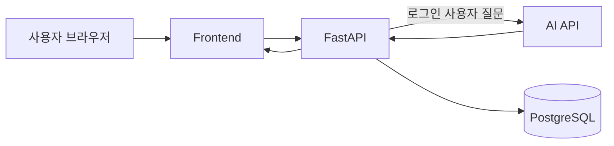

# 시스템 아키텍처

## 전체 흐름

화면은 `frontend/`에서, API와 서버 기능은 `backend/`에서 구현합니다. 브라우저는 FastAPI에 요청하고, 서버가 인증 및 입력을 확인한 뒤 필요하면 AI API와 PostgreSQL을 사용합니다. AI API 키는 서버 환경 변수로만 관리합니다.

## 주요 컴포넌트

| 컴포넌트 | 역할 |
| --- | --- |
| Frontend | 질문 입력과 AI 응답·대화 기록 표시 |
| FastAPI | 웹 요청 처리, 인증·접근 제어, 입력 검증, AI 및 DB 연동 |
| AI API | 질문과 최근 대화 문맥을 바탕으로 답변 생성 |
| PostgreSQL | 사용자 정보 및 질문·응답 로그 저장 |

## 구현 계획 체크리스트

- [x] `frontend/`에서 로그인·회원가입 화면과 질문 입력 채팅 화면 구현
- [x] 채팅 화면에서 AI 답변 표시와 대화 기록 연결 (`POST /api/chat`, `GET /api/me/chats` 사용)
- [x] FastAPI 앱과 `GET /health` 상태 확인 경로 구성
- [x] 회원가입·로그인 및 로그인 상태 접근 제어 (채팅 API 접근 제어는 채팅 구현 때 적용)
- [x] PostgreSQL 사용자·대화 로그 연결 (모델까지, 대화 저장은 채팅 구현 때)
- [ ] 서버에서 AI API 호출 및 타임아웃·실패 처리
- [ ] 최근 대화 문맥 구성
- [ ] 사용자별 대화 기록 조회
- [ ] 요청, AI 호출 결과, DB 저장 결과 로그 기록

## 질문 처리 흐름 계획

1. 로그인한 사용자가 화면에서 질문을 보냅니다.
2. FastAPI가 인증 상태와 입력값을 확인합니다.
3. 서버가 같은 사용자의 최근 대화 일부를 문맥으로 구성해 AI API를 호출합니다.
4. 성공한 질문과 답변을 사용자 식별자 및 생성 시각과 함께 PostgreSQL에 저장합니다.
5. 응답을 화면에 반환합니다. 실패 또는 시간 초과 시 오류를 기록하고 사용자에게 안내합니다.
