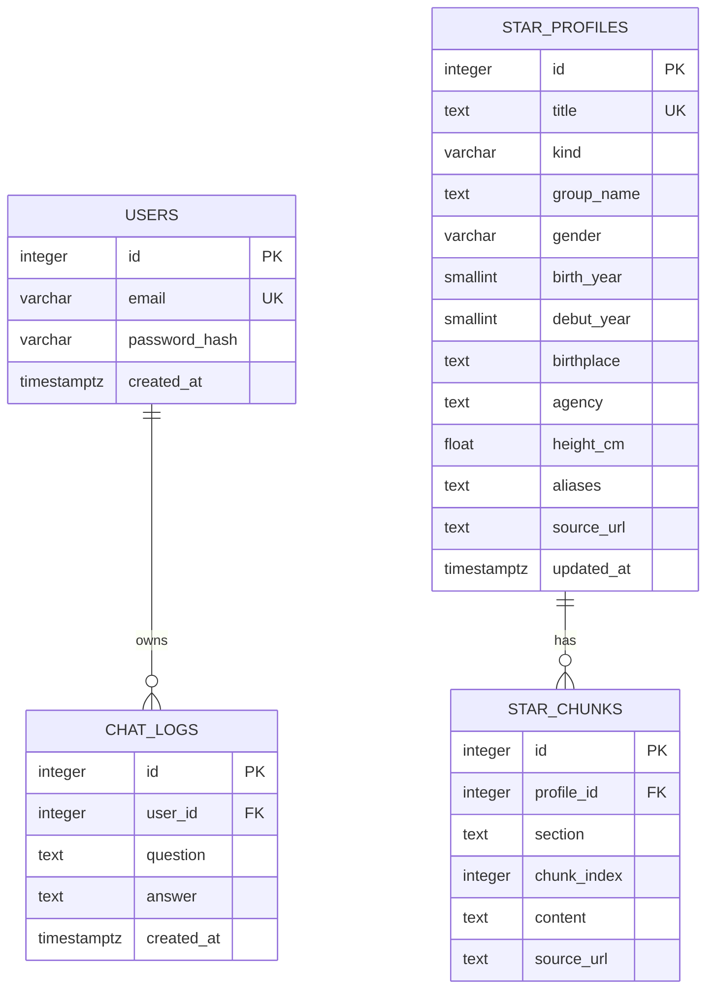

# 데이터베이스 설계

PostgreSQL을 사용합니다. 아래 스키마를 기준으로 구현하고, 팀의 설계가 바뀌면 이 문서와 ERD를 함께 갱신합니다.

## 구현 체크리스트

- [x] PostgreSQL 연결 설정 및 스키마 생성
- [x] 사용자 계정과 비밀번호 해시 저장
- [x] 사용자별 질문·응답·생성 시각 누적 저장
- [x] 로그인 사용자 기준으로 본인 대화만 조회
- [x] DB 확인용 SQL, 스크립트 또는 로그 조회 API/화면 제공

## 관계



한 사용자는 여러 대화 로그를 가질 수 있습니다. 각 로그는 하나의 사용자에게 속합니다.

`star_profiles`, `star_chunks` 는 챗봇이 참고할 스타 자료입니다. 사용자 데이터와 연결하지 않고, 앱이 아니라 적재 스크립트(`python -m scripts.namuwiki.load`)가 채웁니다. 한 스타 문서에 문단 조각이 여러 개 붙습니다.

## 테이블 및 필드

### `users`

| 필드 | 형식 | 설명 |
| --- | --- | --- |
| `id` | 정수, 기본 키 | 사용자 식별자 |
| `email` | 문자열, 고유 | 로그인 계정 식별자 |
| `password_hash` | 문자열 | 비밀번호 해시. 원문 비밀번호는 저장하지 않습니다. |
| `created_at` | 시간대 포함 시각 | 계정 생성 시각 |

### `chat_logs`

| 필드 | 형식 | 설명 |
| --- | --- | --- |
| `id` | 정수, 기본 키 | 대화 로그 식별자 |
| `user_id` | 정수, 외래 키 | `users.id` 참조 |
| `question` | 텍스트 | 사용자가 입력한 질문 |
| `answer` | 텍스트 | AI가 생성한 응답 |
| `created_at` | 시간대 포함 시각 | 대화 생성 시각 |

사용자별 로그 조회는 `user_id`로 제한합니다. 최신 기록을 빠르게 가져오도록 `(user_id, created_at, id)` 인덱스 `ix_chat_logs_user_created`를 둡니다.

### `star_profiles`

나무위키 스타 문서 한 건(인물 또는 그룹)입니다. 값을 못 뽑은 칸은 비워 둡니다(NULL).

| 필드 | 형식 | 설명 |
| --- | --- | --- |
| `id` | 정수, 기본 키 | 스타 식별자. 다시 적재하면 새로 매깁니다 |
| `title` | 텍스트, 고유 | 나무위키 문서 제목 (`잭슨(GOT7)` 처럼 괄호 포함). 동명이인이 많아 이걸 키로 씁니다 |
| `kind` | 문자열 | `person` 또는 `group` |
| `group_name` | 텍스트 | 소속 그룹. 여러 개면 `, ` 로 잇습니다 |
| `gender` | 문자 1개 | `M` / `F`. 분류끼리 엇갈리면 비웁니다 |
| `birth_year` | 작은 정수 | 출생연도 |
| `debut_year` | 작은 정수 | 데뷔연도 |
| `birthplace` | 텍스트 | 출생지 (인포박스 값 그대로, 예: `서울특별시 마포구`) |
| `agency` | 텍스트 | 소속사 (인포박스 첫 값) |
| `height_cm` | 실수 | 키(cm). 120~230 밖의 값은 버립니다 |
| `aliases` | 텍스트 | 다른 이름. 한 줄에 하나 (괄호 뺀 이름, 본명, 예명, 리다이렉트 제목) |
| `source_url` | 텍스트 | `https://namu.wiki/w/<제목 URL 인코딩>` |
| `updated_at` | 시간대 포함 시각 | 적재 시각 |

### `star_chunks`

정제한 본문을 500~1000자 문단 단위로 나눈 조각입니다. 검색과 답변 근거에 씁니다.

| 필드 | 형식 | 설명 |
| --- | --- | --- |
| `id` | 정수, 기본 키 | 조각 식별자 |
| `profile_id` | 정수, 외래 키 | `star_profiles.id` 참조 (스타 행을 지우면 같이 지워짐) |
| `section` | 텍스트 | 문서 안의 섹션 경로 (예: `활동 > 2020년`, 하위 문서는 `여담 > 습관`). 첫 조각은 인포박스를 옮긴 `프로필` |
| `chunk_index` | 정수 | 스타별 0부터 이어지는 순번. `(profile_id, chunk_index)` 고유 |
| `content` | 텍스트 | 정제한 본문 (1000자 이하) |
| `source_url` | 텍스트 | 이 조각이 나온 문서 주소 (하위 문서면 하위 문서 주소) |

인덱스:

- `star_profiles.title` 고유 인덱스, `star_chunks (profile_id, chunk_index)` 고유 인덱스
- 검색용 인덱스는 적재 스크립트가 PostgreSQL 에서만 만듭니다.
  - `star_profiles (kind, gender)`, `(debut_year)`, `(birth_year)` B-tree 인덱스 (채팅 검색의 조건 필터용)
  - `pg_trgm` 을 쓸 수 있으면 `title`, `aliases` 에 `gin_trgm_ops` 인덱스 (`LIKE '%아이유%'`, 유사도 검색용)
  - 확장을 만들 권한이 없으면 대신 `to_tsvector('simple', ...)` 전문 검색 인덱스를 만듭니다.
  - `content` 인덱스는 `--content-index trgm` 일 때만 만듭니다 (전체 덤프 기준 약 300MB, `docs/DATA.md` 참고).

두 테이블에는 출처와 라이선스(CC BY-NC-SA 2.0 KR, 비영리)를 적은 테이블 주석이 붙어 있습니다. 자세한 이용 조건은 `docs/DATA.md` 를 봅니다.

## 대화 로그 확인 방법

- API: 로그인한 뒤 `GET /api/me/chats?limit=N`으로 본인 기록을 봅니다. 자세한 형식은 [API 명세](API.md)에 있습니다.
- SQL: `scripts/check_logs.sql`에 사용자별 대화 수와 한 사용자의 최근 20건을 보는 쿼리가 있습니다.

```bash
psql "$DATABASE_URL" -v email='user@example.com' -f scripts/check_logs.sql
```

`psql`은 `postgresql://` 형식 주소를 받으므로, `DATABASE_URL`이 `postgresql+psycopg://`로 시작하면 `+psycopg`를 빼고 넣습니다.
