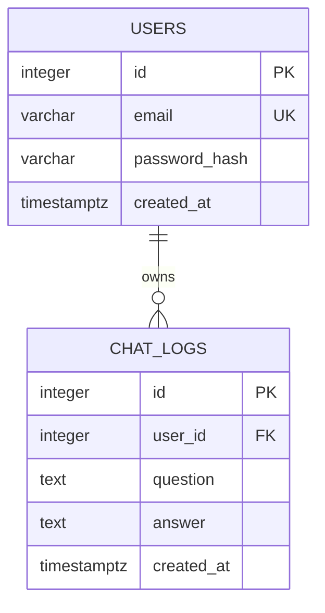

# 데이터베이스 설계

PostgreSQL을 사용합니다. 아래 스키마를 기준으로 구현하고, 팀의 설계가 바뀌면 이 문서와 ERD를 함께 갱신합니다.

## 구현 체크리스트

- [x] PostgreSQL 연결 설정 및 스키마 생성
- [x] 사용자 계정과 비밀번호 해시 저장
- [ ] 사용자별 질문·응답·생성 시각 누적 저장
- [ ] 로그인 사용자 기준으로 본인 대화만 조회
- [ ] DB 확인용 SQL, 스크립트 또는 로그 조회 API/화면 제공

## 관계

한 사용자는 여러 대화 로그를 가질 수 있습니다. 각 로그는 하나의 사용자에게 속합니다.

## 테이블 및 필드

### `users`

| 필드 | 형식 | 설명 |
| --- | --- | --- |
| `id` | 정수, 기본 키 | 사용자 식별자 |
| `email` | 문자열, 고유 | 로그인 계정 식별자 |
| `password_hash` | 문자열 | 비밀번호 해시. 원문 비밀번호는 저장하지 않습니다. |
| `created_at` | 시간대 포함 시각 | 계정 생성 시각 |

### `chat_logs`

| 필드 | 형식 | 설명 |
| --- | --- | --- |
| `id` | 정수, 기본 키 | 대화 로그 식별자 |
| `user_id` | 정수, 외래 키 | `users.id` 참조 |
| `question` | 텍스트 | 사용자가 입력한 질문 |
| `answer` | 텍스트 | AI가 생성한 응답 |
| `created_at` | 시간대 포함 시각 | 대화 생성 시각 |

사용자별 로그 조회는 `user_id`로 제한합니다. 최신 기록을 효율적으로 가져올 수 있도록 해당 필드와 생성 시각에 대한 인덱스를 검토합니다. DB 확인용 SQL, 스크립트 또는 로그 조회 API/화면 중 제공하는 방법을 정해 체크리스트를 갱신합니다.
