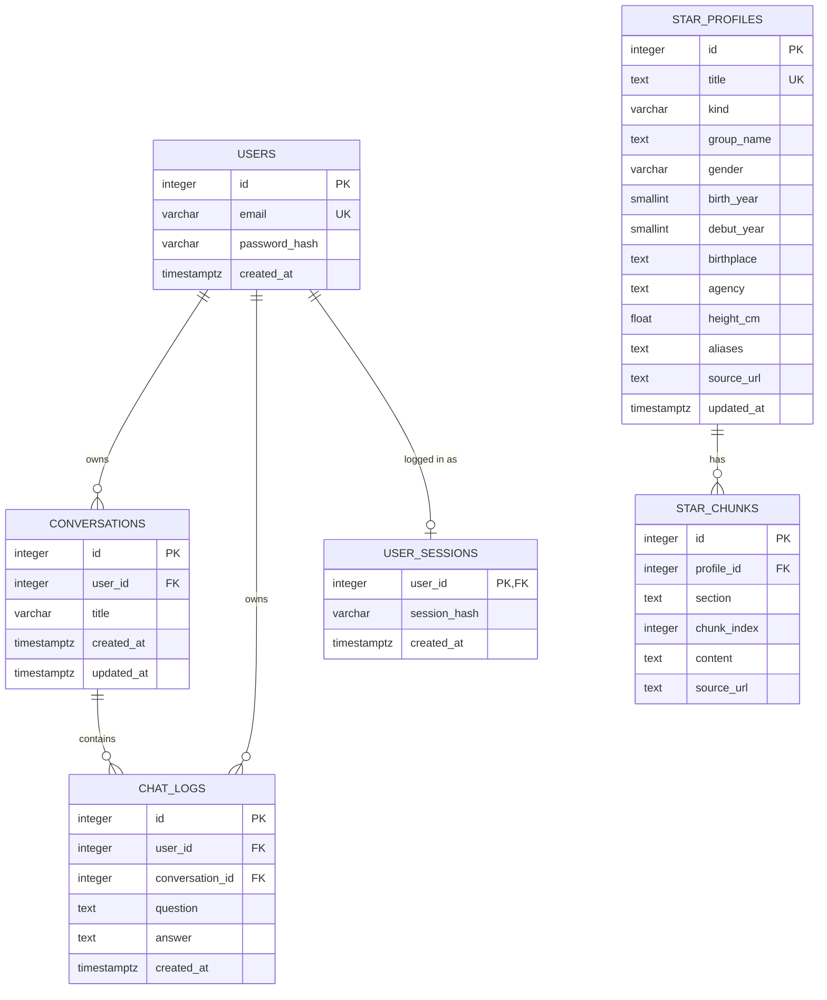

# 데이터베이스 설계

PostgreSQL을 사용합니다. 테이블은 `PYTHONPATH=backend python -m app.init_db`가 `create_all`로 만들고, 이미 있는 테이블은 그대로 둡니다. 대화방 기능 전에 만든 DB라면 같은 명령이 `chat_logs.conversation_id`를 추가하고 기존 대화를 묶습니다([아래](#기존-db-업그레이드)). 운영에서는 Railway의 Pre-deploy Command로 배포 때마다 실행합니다([DEPLOY.md](DEPLOY.md)).

## 관계



한 사용자는 여러 대화방을 가지고, 대화방 하나에 대화 로그(질문·답변 한 쌍)가 여러 개 들어갑니다. 각 로그는 한 사용자와 한 대화방에 속합니다. 로그인 세션은 사용자당 최대 하나입니다.

`star_profiles`, `star_chunks` 는 챗봇이 참고할 스타 자료입니다. 사용자 데이터와 연결하지 않고, 앱이 아니라 적재 스크립트(`python -m scripts.namuwiki.load`)가 채웁니다. 한 스타 문서에 문단 조각이 여러 개 붙습니다.

## 테이블 및 필드

### `users`

| 필드 | 형식 | 설명 |
| --- | --- | --- |
| `id` | 정수, 기본 키 | 사용자 식별자 |
| `email` | 문자열, 고유 | 로그인 계정 식별자 |
| `password_hash` | 문자열 | 비밀번호 해시. 원문 비밀번호는 저장하지 않습니다. |
| `created_at` | 시간대 포함 시각 | 계정 생성 시각 |

관리자 계정도 같은 `users` 행입니다. 관리자 여부는 DB에 저장하지 않고 로그인한 이메일이 환경 변수 `ADMIN_EMAIL`과 같은지로 판단하므로 스키마 변경은 없습니다. `init_db`는 `ADMIN_EMAIL`, `ADMIN_PASSWORD`가 있고 그 계정이 없을 때만 행을 하나 추가합니다.

### `user_sessions`

계정마다 지금 유효한 로그인 하나를 기록합니다. 새로 로그인하면 행을 덮어쓰므로 이전 세션은 `SESSION_REPLACED`로 끊깁니다([API 명세](API.md#계정당-세션-하나)).

| 필드 | 형식 | 설명 |
| --- | --- | --- |
| `user_id` | 정수, 기본 키·외래 키 | `users.id` 참조 (사용자를 지우면 같이 지워짐) |
| `session_hash` | 문자열(64) | 세션 쿠키에 든 세션 ID의 SHA-256 해시(16진수). 원래 ID는 저장하지 않습니다. |
| `created_at` | 시간대 포함 시각 | 마지막 로그인 시각 |

로그아웃하면 행이 지워집니다. 이 테이블은 `python -m app.init_db`(`create_all`)가 만들고, 이미 있는 DB에서 다시 실행하면 기존 테이블은 그대로 두고 이 테이블만 추가됩니다.

### `conversations`

대화방 하나입니다. 채팅 문맥(최근 5쌍)과 후속 질문의 앞 스타는 같은 대화방 안에서만 읽습니다.

| 필드 | 형식 | 설명 |
| --- | --- | --- |
| `id` | 정수, 기본 키 | 대화방 식별자 |
| `user_id` | 정수, 외래 키 | `users.id` 참조 (사용자를 지우면 같이 지워짐) |
| `title` | 문자열(100) | 첫 질문 앞 40자(더 길면 끝에 `…`). 백필한 방은 `이전 대화` |
| `created_at` | 시간대 포함 시각 | 대화방 생성 시각 |
| `updated_at` | 시간대 포함 시각 | 마지막으로 답변을 저장한 시각. 목록 정렬에 씁니다 |

`(user_id, updated_at)` 인덱스 `ix_conversations_user_updated`로 사용자별 대화방 목록을 최신순으로 찾습니다. 새 대화방은 첫 답변을 저장할 때 같은 트랜잭션으로 만들어서, AI 호출이나 저장이 실패하면 빈 방이 남지 않습니다. 대화를 하나씩 지우다 방이 비면 방도 지웁니다.

### `chat_logs`

| 필드 | 형식 | 설명 |
| --- | --- | --- |
| `id` | 정수, 기본 키 | 대화 로그 식별자 |
| `user_id` | 정수, 외래 키 | `users.id` 참조 |
| `conversation_id` | 정수, 외래 키, NULL 허용 | `conversations.id` 참조 (대화방을 지우면 같이 지워짐). NULL은 업그레이드 전 행뿐이고 `init_db`가 채웁니다 |
| `question` | 텍스트 | 사용자가 입력한 질문 |
| `answer` | 텍스트 | AI가 생성한 응답. 스타 자료를 쓴 경우 서버가 붙인 출처 줄까지 포함 |
| `created_at` | 시간대 포함 시각 | 대화 생성 시각 |

AI 답변을 받은 대화만 저장합니다. 사용자별 로그 조회와 삭제(`DELETE /api/me/chats/{chat_id}`)는 `user_id`로 제한합니다. 관리자 API는 `user_id`로 묶어 사용자별 대화 수와 마지막 대화 시각을 집계합니다. 최신 기록을 빠르게 가져오도록 `(user_id, created_at, id)` 인덱스 `ix_chat_logs_user_created`를, 대화방별 조회용으로 `conversation_id` 인덱스 `ix_chat_logs_conversation_id`를 둡니다.

### 기존 DB 업그레이드

`init_db`는 다시 실행해도 결과가 같습니다.

1. `create_all`로 없는 테이블(`conversations` 등)을 만듭니다.
2. SQLAlchemy inspector로 `chat_logs.conversation_id`가 없으면 `ALTER TABLE chat_logs ADD COLUMN conversation_id INTEGER REFERENCES conversations(id) ON DELETE CASCADE`로 추가하고, `CREATE INDEX IF NOT EXISTS ix_chat_logs_conversation_id`를 실행합니다.
3. `conversation_id`가 NULL인 로그가 있는 사용자마다 `이전 대화` 방을 하나 만들고(생성 시각은 그 로그들의 가장 이른 시각, `updated_at`은 가장 늦은 시각) 로그를 그 방에 넣습니다. 다시 실행하면 NULL인 로그가 없으므로 아무것도 바꾸지 않습니다.

### `star_profiles`

나무위키 스타 문서 한 건(인물 또는 그룹)입니다. 값을 못 뽑은 칸은 비워 둡니다(NULL).

| 필드 | 형식 | 설명 |
| --- | --- | --- |
| `id` | 정수, 기본 키 | 스타 식별자. 다시 적재하면 새로 매깁니다 |
| `title` | 텍스트, 고유 | 나무위키 문서 제목 (`잭슨(GOT7)` 처럼 괄호 포함). 동명이인이 많아 이걸 키로 씁니다 |
| `kind` | 문자열 | `person` 또는 `group` |
| `group_name` | 텍스트 | 소속 그룹. 여러 개면 `, ` 로 잇습니다 |
| `gender` | 문자 1개 | `M` / `F`. 분류끼리 엇갈리면 비웁니다 |
| `birth_year` | 작은 정수 | 출생연도 |
| `debut_year` | 작은 정수 | 데뷔연도 |
| `birthplace` | 텍스트 | 출생지 (인포박스 값 그대로, 예: `서울특별시 마포구`) |
| `agency` | 텍스트 | 소속사 (인포박스 첫 값) |
| `height_cm` | 실수 | 키(cm). 120~230 밖의 값은 버립니다 |
| `aliases` | 텍스트 | 다른 이름. 한 줄에 하나 (괄호 뺀 이름, 본명, 예명, 리다이렉트 제목) |
| `source_url` | 텍스트 | `https://namu.wiki/w/<제목 URL 인코딩>` |
| `updated_at` | 시간대 포함 시각 | 적재 시각 |

### `star_chunks`

정제한 본문을 500~1000자 문단 단위로 나눈 조각입니다. 검색과 답변 근거에 씁니다.

| 필드 | 형식 | 설명 |
| --- | --- | --- |
| `id` | 정수, 기본 키 | 조각 식별자 |
| `profile_id` | 정수, 외래 키 | `star_profiles.id` 참조 (스타 행을 지우면 같이 지워짐) |
| `section` | 텍스트 | 문서 안의 섹션 경로 (예: `활동 > 2020년`, 하위 문서는 `여담 > 습관`). 첫 조각은 인포박스를 옮긴 `프로필` |
| `chunk_index` | 정수 | 스타별 0부터 이어지는 순번. `(profile_id, chunk_index)` 고유 |
| `content` | 텍스트 | 정제한 본문 (1000자 이하) |
| `source_url` | 텍스트 | 이 조각이 나온 문서 주소 (하위 문서면 하위 문서 주소) |

인덱스:

- `star_profiles.title` 고유 인덱스, `star_chunks (profile_id, chunk_index)` 고유 인덱스
- 검색용 인덱스는 적재 스크립트가 PostgreSQL 에서만 만듭니다.
  - `star_profiles (kind, gender)`, `(debut_year)`, `(birth_year)` B-tree 인덱스 (채팅 검색의 조건 필터용)
  - `pg_trgm` 을 쓸 수 있으면 `title`, `aliases` 에 `gin_trgm_ops` 인덱스 (`LIKE '%아이유%'`, 유사도 검색용)
  - 확장을 만들 권한이 없으면 대신 `to_tsvector('simple', ...)` 전문 검색 인덱스를 만듭니다.
  - `content` 인덱스는 `--content-index trgm` 일 때만 만듭니다 (전체 덤프 기준 약 300MB, `docs/DATA.md` 참고).

두 테이블에는 출처와 라이선스(CC BY-NC-SA 2.0 KR, 비영리)를 적은 테이블 주석이 붙어 있습니다. 자세한 이용 조건은 `docs/DATA.md` 를 봅니다.

## 대화 로그 확인 방법

- API: 로그인한 뒤 `GET /api/me/chats?limit=N`으로 본인 기록을 봅니다. 형식은 [API 명세](API.md#get-apimechats)에 있습니다.
- SQL: `scripts/check_logs.sql`에 사용자별 대화 수·마지막 대화 시각과, 한 사용자의 최근 20건(질문·답변 앞 50자)을 보는 쿼리가 있습니다.

```bash
psql "$DATABASE_URL" -v email='user@example.com' -f scripts/check_logs.sql
```

`psql`은 `postgresql://` 형식 주소를 받으므로, `DATABASE_URL`이 `postgresql+psycopg://`로 시작하면 `+psycopg`를 빼고 넣습니다. 실행 결과 예시는 [README](../README.md#sql로-확인하기)에 있습니다.
